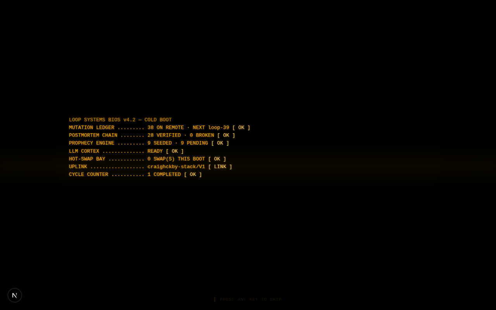
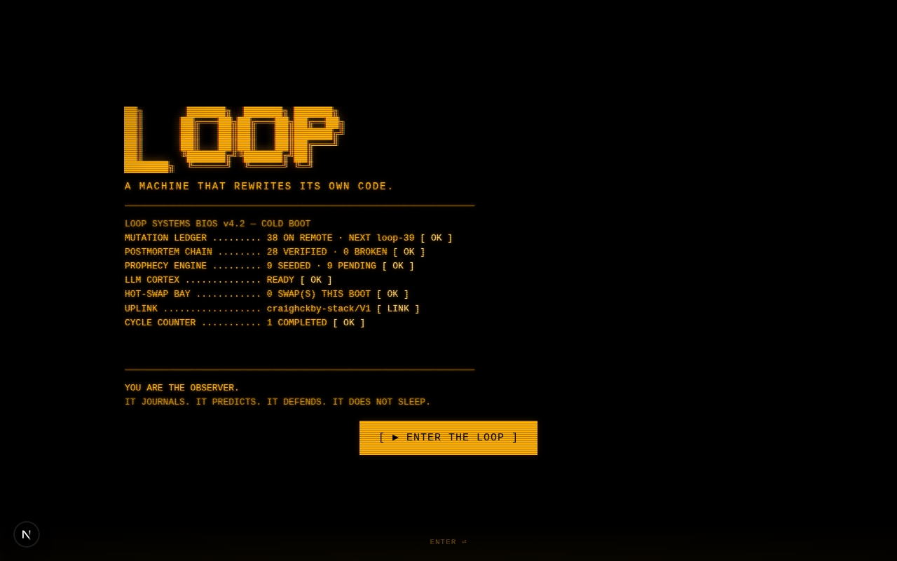
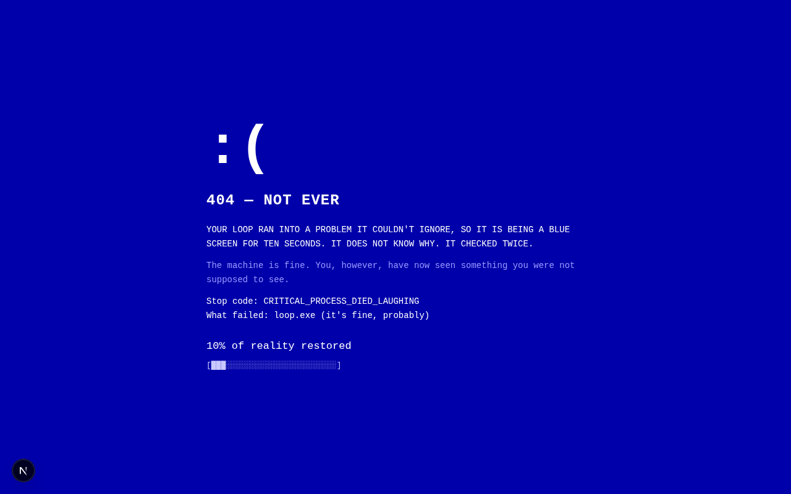
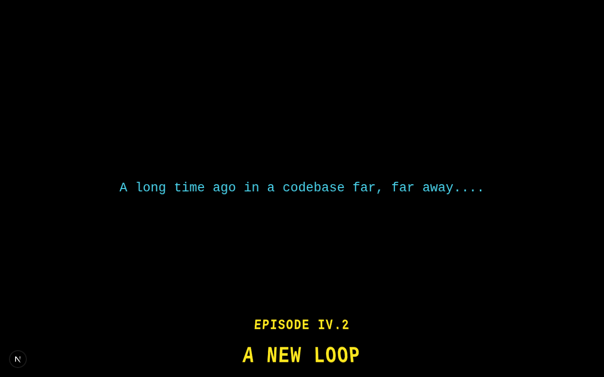
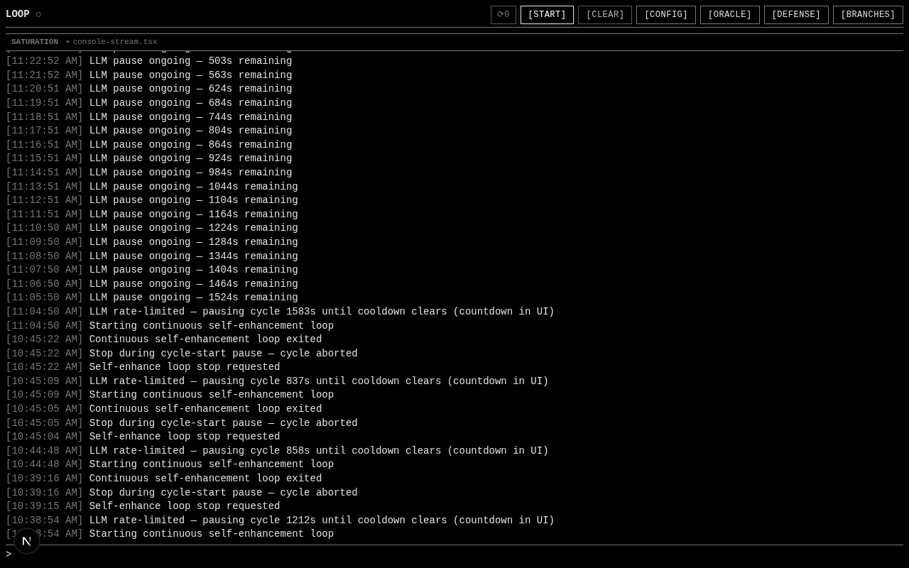
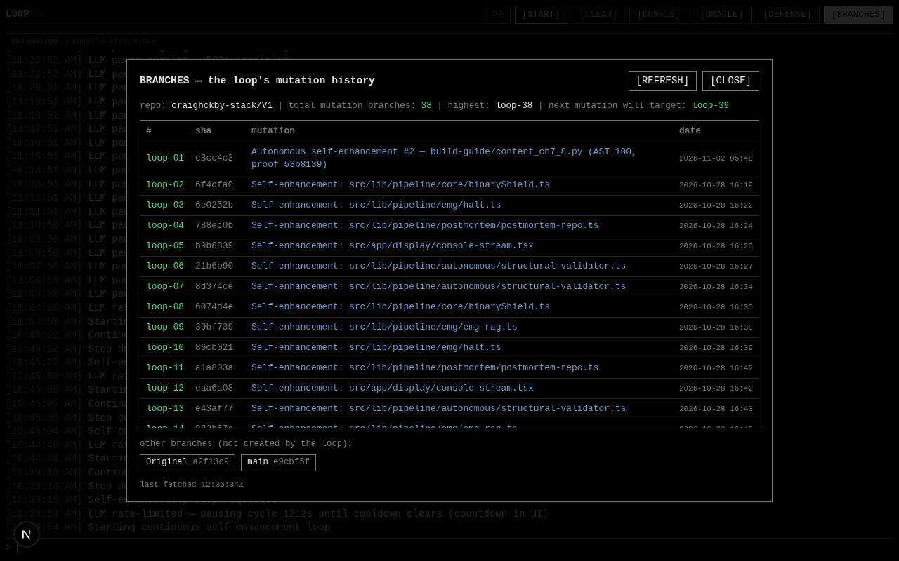
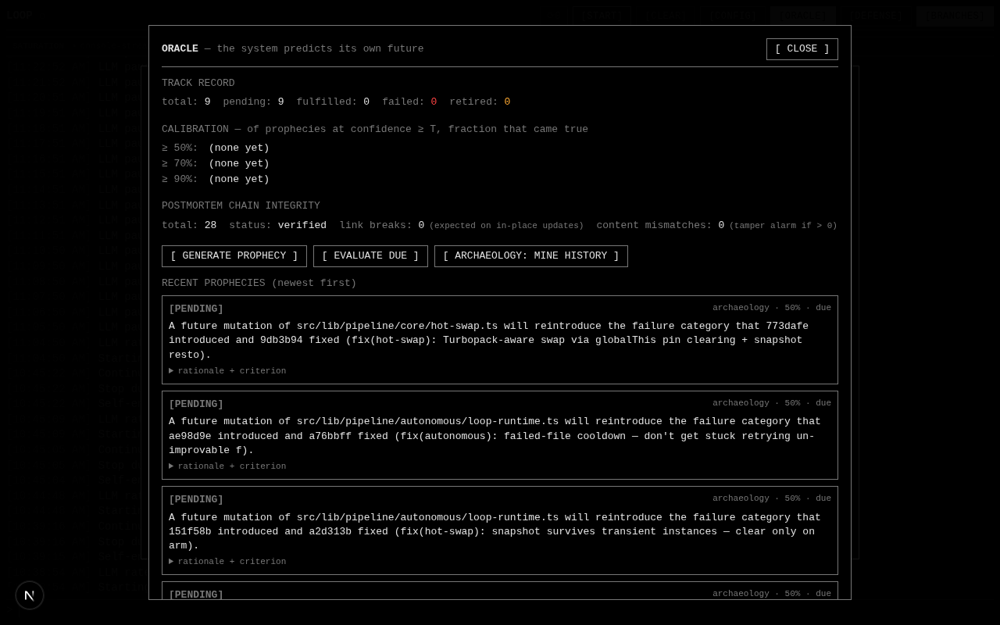
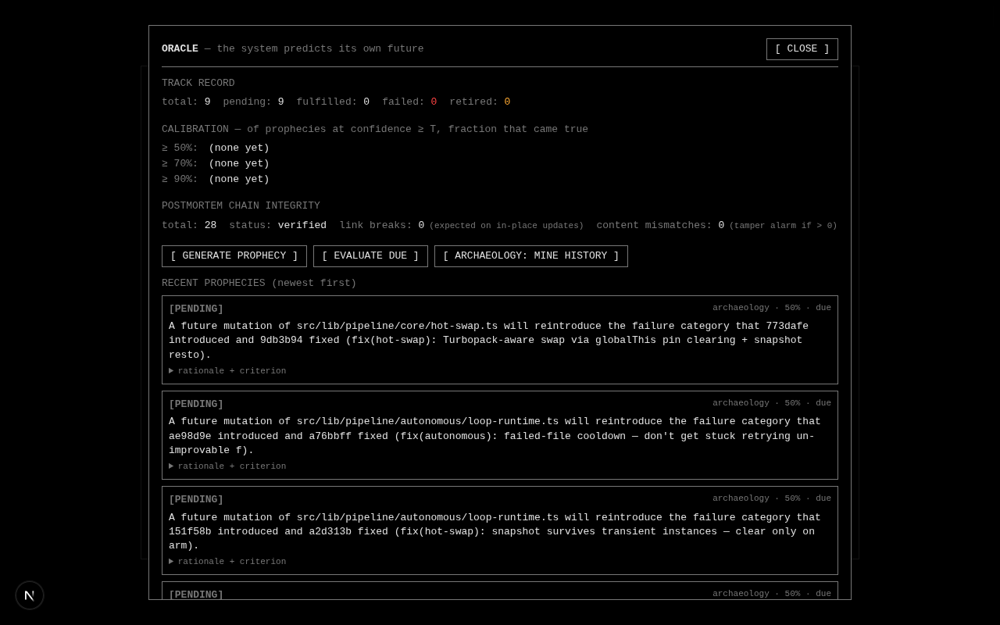

# LOOP

> A program that rewrites its own source code, gates every mutation through a real compiler, and pushes the proof to GitHub — one `loop-NN` branch per successful mutation.



---

## What this actually is

LOOP is a Next.js app that runs a continuous loop in the background:

1. **Scan** its own source files (the ones it's allowed to touch).
2. **Pick** one file to improve.
3. **Read the postmortems** for that file (if it has failed before) and inject them into the LLM prompt as constraints.
4. **Ask an LLM** to improve the file.
5. **Gate** the result: TypeScript compiler, AST diff (no symbols dropped), sanitizer (no branding stripped), debate tribunal.
6. **Verdict**: pass → commit + push to a fresh `loop-NN` branch, resolve any open postmortems. Fail → revert, write a postmortem, try again next cycle.
7. Goto 1. Forever.

It is not AGI. It is not dangerous. It is a bounded, compiler-gated pipeline that safely applies an LLM's proposed edits to its own source code. The clever part is the gating, not the generation.

---

## What it looks like

### The boot ceremony (cold boot)

The system boots like a 1980s CRT terminal. It fetches its own live vitals from its own APIs while the phosphor warms up, stamps a BIOS-style POST, then addresses you:

| | |
|---|---|
| **POST** — live vitals stamp in one by one |  |
| **Invite** — the machine asks you to enter |  |

The POST is honest: any vital it can't read stamps `[ ?? ]` in amber. It never fakes an `OK`.

### The prank (press ENTER)

Per the owner's decree — "for shits and giggles, volume 100 each time, no mute":

| | |
|---|---|
| **Blue screen** — 404 NOT EVER (10s, floppy drive seeking) |  |
| **Star Wars crawl** — explains what the system is (24s, Imperial March) |  |

ESC is the hidden mercy hatch. The prank fires on every entry, warm or cold.

### The terminal

After the ceremony, you get the actual interface:



Black background, white text, red only when something breaks. The header: `LOOP ●` (heartbeat), `[START]`, `[CLEAR]`, `[CONFIG]`, `[ORACLE]`, `[DEFENSE]`, `[BRANCHES]`.

Type commands:
- `start` — kick off the loop. Renders a live activity snapshot, then the stream takes over.
- `stop` — halt.
- `status` — current snapshot, including the next branch number.
- `about` — the elevator pitch.
- `clear` — wipe the console.
- `config` — open the git config modal.

A live stream scrolls in real time: every scan, gate, push, retry, and backoff appears as it happens. Even when the LLM is rate-limiting and a single call takes ~150s of retries, you see each retry fire — no silent gaps.

### The panels

| | | |
|---|---|---|
| **Branches** — every `loop-NN` branch is one successful mutation pushed to GitHub, with a link to the commit |  |
| **Oracle** — the system predicts its own operational future and grades the answers |  |
| **Config** — push target (token, repo, visibility, auto-create) |  |
| **Defense** — duress, red-team, secret-scan concepts grafted from external repos |  |

---

## The two safety mechanisms

A system that rewrites its own code is dangerous — what stops it from "improving" away its own OFF switch?

### 1. The Ratchet — tests only get stricter

Every time the loop commits an improvement to a file, it also writes **characterization tests** that pin the behaviour of that file. These tests are **write-once** — once pinned, they cannot be loosened. The system's behaviour gets increasingly locked while its implementation gets increasingly clean. It can't weaken its own pins to escape its own standards.

### 2. The Postmortem — failures only get safer

When an attempt fails, the system writes a postmortem against that exact file path: what broke (`failureType`), the evidence (machine-copied facts), and a constraint the LLM must obey next time. The next time the loop picks that file, it pulls the postmortem and injects it into the prompt:

```
--- POSTMORTEM CONSTRAINTS (this file failed 2 time(s) before) ---
FAILURE TYPE: AST_SYMBOL_DROPPED
SYMPTOM: function `parseHeader` was deleted from the output
DO NOT: remove any exported symbols; refactor in place only.
```

If the AI tries the same dumb refactor again, the gate catches it again, the `attempts` counter ticks, the constraint gets sharper. When it finally succeeds, the postmortem is marked `resolved`. The loop gets wiser about its own codebase as it runs.

---

## The branch model

Each successful enhancement pushes to its own git branch:

```
loop-01  ← first full mutation
  └─ loop-02  ← second, built on loop-01's tip
       └─ loop-03 ← third
            └─ ...loop-38 (current)
```

- **Each branch = one successful mutation.** Failed attempts don't get a branch — they go to the postmortem DB. So `loop-NN` counts wins only.
- **Git-native rollback.** `git checkout loop-37` gives you the pre-bad state. One command.
- **Git-native diff.** `git diff loop-37..loop-38` shows exactly what one cycle did: one file, one enhancement, its test pin. That's the audit trail, for free.
- **The branch list IS the changelog.**

---

## The boundary — what it can and can't touch

| Layer | Mutable? |
|---|---|
| **The brain** — loop runtime, event bus, push auth, typecheck, AST gate, sanitizer, debate tribunal, LLM callers, task generator | 🔒 Never. Permanently protected. |
| **The body** — pipeline stages, helpers, the display layer | ✏️ Yes. This is the mutation scope. |
| **The control surface** — `page.tsx`, `layout.tsx` (your STOP/START/CONFIG buttons, command input, config modal) | 🔒 Never. You always have the kill switch. |
| **Everything else** — UI components, API routes, Prisma schema | 🔒 Outside the loop's awareness. |

The system can change **how** things look. It can **never** change **what you control**. If it could rewrite its own control surface, it could remove the STOP button — this is structurally impossible.

---

## Current state (factual)

As of this README:

- **38 mutation branches** on GitHub (`loop-01` through `loop-38`), next will be `loop-39`.
- **28 postmortems** in the chain, **0 broken links** (every postmortem traces to a real commit).
- **9 prophecies** seeded by the Oracle, **9 pending** evaluation.
- **136 files in mutation scope** — pipeline logic, UI components, API routes, and the Prisma schema (see below).
- The repo (`craighckby-stack/V1`) is **public** — commit links in the BRANCHES dialog resolve for anyone.

The system is currently running against a free-tier LLM API, which rate-limits frequently. When it does, the loop backs off honestly — each retry fires a log line in real time rather than going silent. No fake progress.

---

## Compounding intelligence — the Lesson system

Postmortems are per-file and reactive: a scar log. Knowing `halt.ts` hates function removal doesn't help when the loop picks `sanitizer.ts`. **Lessons** are the transfer layer — general rules distilled from AGGREGATE history that inject into EVERY enhance prompt:

```
--- LEARNED LESSONS (general rules this system distilled from its own history) ---
1. Never remove error-handling branches or empty catch blocks without
   replacing them with equal-or-better handling — the debate tribunal
   rejects 'simplification' of error paths...
--- END LEARNED LESSONS ---
```

The loop is **distill → inject → measure → prune**:

1. **Distill** — every 10 cycles, one LLM pass over aggregate failure patterns (failure-type counts, most-attempted files, recent successes) extracts up to 3 general rules. Deduped against existing lessons, including PRUNED ones (a rule that already failed to transfer isn't re-derived).
2. **Inject** — top 5 lessons by trust score go into every prompt. Global, not per-file. A lesson from pipeline failures shapes a UI component mutation.
3. **Measure** — every mutation verdict feeds back: pass → `helped++`, fail → `hindered++` for exactly the lessons that were injected.
4. **Prune** — score = helped/(helped+hindered). Below 0.35 after ≥4 observations → deactivated. The lesson didn't transfer; it stops costing prompt tokens.

This is meta-learning with a real feedback signal: the system learns WHICH of its own lessons actually raise the pass rate, keeps only those, and the score proves it. That's what compounds — each surviving lesson makes future mutations more likely to succeed, measurably.

---

## The mutation scope — 136 files

| Scope | Files | Gate chain |
|---|---|---|
| Pipeline logic (`src/lib/pipeline/`) | 33 | ratchet pin → tsc + AST → debate → test gate |
| Display layer (`src/app/display/`) | 1 | same |
| UI components (`src/components/`) | 63 | same |
| API routes (`src/app/api/`) | 38 | same |
| Prisma schema (`prisma/schema.prisma`) | 1 | **additive-only gate** (see below) |

Everything the system IS lives inside its own reach: the loop can enhance the components that render it, the routes that serve it, and (additively) the database that remembers for it. Churn is bounded by the saturation lockout — 3 no-growth cycles per file and it locks out until the operator unlocks it.

### The additive-only schema gate

The most dangerous thing the loop could touch is its own memory substrate. A bad schema change can destroy the postmortem DB. So schema mutations pass through the strictest gate in the pipeline:

- **Allowed**: new model blocks; new nullable/`@default()` fields on non-protected models (existing rows backfill).
- **Rejected**: any removal, rename, or type change; ANY edit to the protected memory models (Postmortem, Lesson, GitPushTarget, LlmConfig, Prophecy, SystemFlag).
- **Chain**: structural diff check → `prisma validate` → `db push` → canary round-trip (a fresh child process reads the memory tables through the regenerated client). Any step failing → the original schema is restored and re-pushed. The loop can GROW its memory but never EDIT or FORGET it.

### What stays protected

The loop's own brain (gate chain, loop runtime, push auth, LLM wrappers, the lesson store, the schema gate, the protection list itself), the UI control surface (`page.tsx` — your STOP button), the control API subtree (`api/self-enhance/**` — the backend of the kill switch), the health probe, and `src/lib/db.ts`. A self-improving system must not be able to rewrite its own OFF switch, its own judges, or its own memory.

---

## Tech stack

- **Next.js 16** (App Router, Turbopack) + **TypeScript 5**
- **Tailwind CSS 4** + **shadcn/ui** (New York)
- **Prisma ORM** + SQLite
- **Socket.io** for the real-time activity stream (mini-service on port 3003)
- **TypeScript Compiler API** for the AST diff gate
- **z-ai-web-dev-sdk** for LLM calls (server-side only)
- **Web Audio API** for the synthesized boot soundtrack (no audio assets — all oscillators)

---

## Quick start

```bash
bun install
bun run db:push
bun run dev

# In another terminal — the real-time stream mini-service
cd mini-services/chat-service && bun run dev
```

Open the preview panel. Type `start`. Watch it work.

To configure the push target (so mutations land on GitHub), type `config` or click `[CONFIG]` and paste a classic PAT (repo scope) + `owner/repo`.

---

## Honest limitations

- **The LLM has to be reachable.** The loop depends on an external LLM endpoint. When it returns 429s, the loop backs off honestly — each retry fires a log line. If the endpoint is hard-down, every cycle completes structurally (scan → attempt → fail → next) but produces zero mutations.
- **The first attempt at any file is the dumbest.** The postmortem is written only after the first failure. Every subsequent attempt is informed.
- **The compounding is real but bounded.** The Lesson system adds measured transfer (general rules that raise the pass rate across files, with a score that proves it) — but it compounds prompt-context quality, not capability. The system gets better at making mutations that PASS; it does not get better at understanding code beyond what the LLM already understood. The ceiling is the LLM; the lessons just stop you paying for the same mistake twice.
- **The intelligence is outsourced.** The LLM does the generation; the system's actual cleverness is in the gating — TypeScript compiler, structural validator, postmortem chain, push pipeline. The system is a well-built scaffold around an LLM that proposes diffs.
- **The postmortem chain is the system vouching for itself.** "Verified" means the LLM checked its own work and the validator passed — not external verification. Same with the Oracle: it predicts its own operational outcomes, which is a neat closed loop but self-referential, not external-world modeling.
- **Push target has to be configured to see branches on GitHub.** Without a configured PAT + repo, the loop falls back to commit-only (local commits, no `loop-NN` branches on a remote).

---

## What this is not

- Not AGI. Not conscious. Not dangerous. Not a demo that stops when you stop watching.
- Not a parlour trick either — it's a real, running, bounded autonomous self-mutation experiment that has produced 38 compiler-verified patches to its own source code and pushed them to a public git history you can audit right now.

The engineering is in the gating, the persistence (3-tier state survival across sandbox restarts), and the boundary (the loop can't rewrite its own OFF switch). That's the craft. The LLM is the easy part.

---

## License

MIT. The system rewrites itself; you own what it produces.
