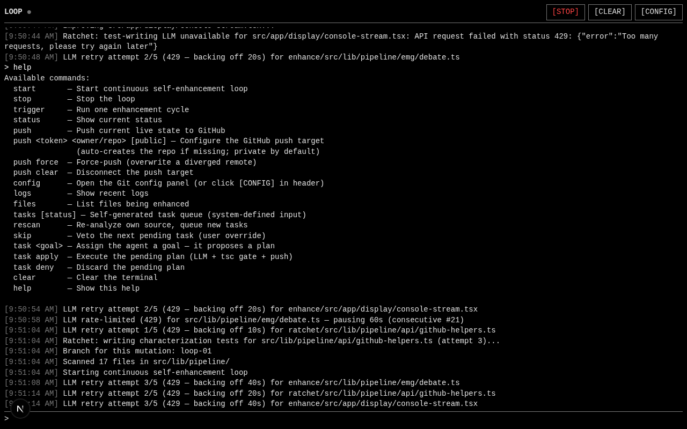
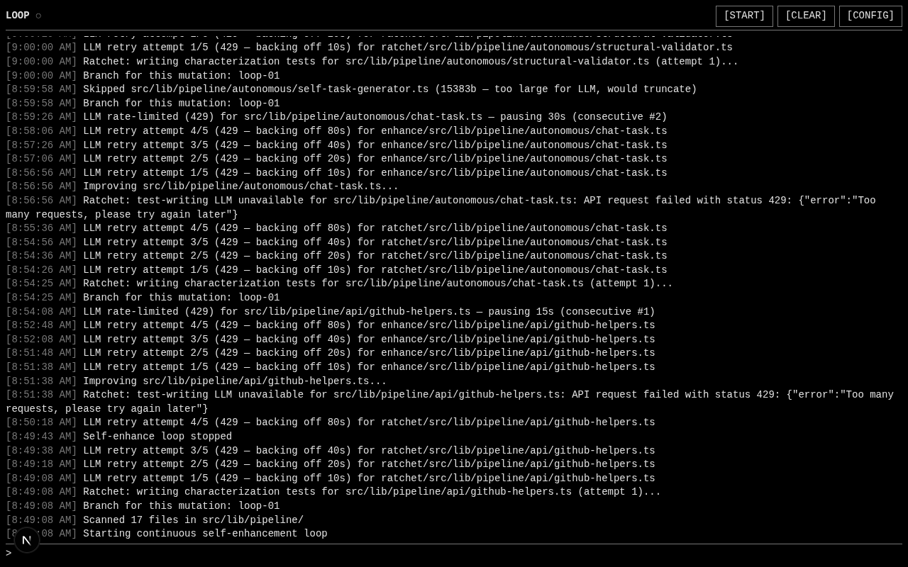
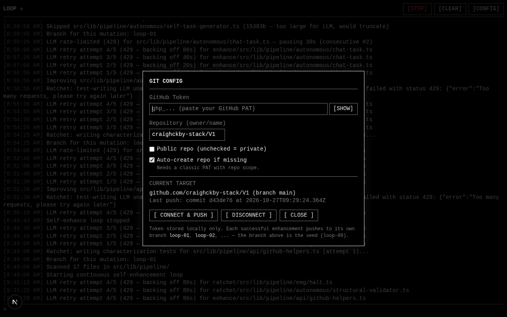

# LOOP

> A program that rewrites its own code, by itself, forever — and **remembers every failure** so it never makes the same mistake twice.



---

## What is this? (the dumb version)

**LOOP is a website that edits its own code.**

That's it. You open it in your browser. You see a black terminal. You type `start`. The program starts reading its own source files, picking one, asking an AI to improve it, checking the change didn't break anything, and if it passed — saving it. Then it picks the next file. Forever.

While it does that, a live stream scrolls on your screen so you can watch it happen.

## Why does it exist?

Because every other "AI improves your code" tool is either:

- **Copilot autocomplete** — guesses one line at a time, breaks things, hopes you notice.
- **A one-shot refactor script** — runs once, forgets everything, leaves you with the mess.

LOOP is different in one specific way: **when it fails, it remembers why.**

Every time a change is rejected by a safety gate, LOOP writes a little case file (a "postmortem") against that exact file. The next time it tries to improve that file, it reads the postmortem out loud to the AI: *"last time you tried this, you deleted a function — don't do that again."* If the AI tries the same dumb thing, it gets caught again, the postmortem gets sharper. When the change finally succeeds, the postmortem is marked resolved.

So the loop isn't just spinning — it's getting wiser about its own codebase as it runs. The 100th cycle is fundamentally smarter than the 1st, because it's carrying the lessons of the 99 failures before it.

That's the whole point. Not "a program that edits its own code" (parlour trick). **A program that fails, remembers why, and never makes the same mistake twice.**

## See it live

The app runs in the preview panel on the right side of this interface. Click **"Open in New Tab"** above the preview panel to view LOOP in a separate browser tab, then type `start` and watch it work.

| | |
|---|---|
| **Source on GitHub** | https://github.com/craighckby-stack/V1 |
| **Stack** | Next.js 16 · TypeScript · Prisma + SQLite · z-ai-web-dev-sdk |
| **Status** | Working. The LLM endpoint is currently rate-limiting (429s), so you'll see real retry log lines in the stream — the system is honest about it. |

---

## What It Actually Does

A continuous loop runs in the background. Every cycle:

1. **Scan** — looks at its own source code (the files it's allowed to touch).
2. **Pick** — selects one file to improve.
3. **Check the scar log** — if that file has failed before, pulls up the postmortem and injects its constraints into the AI's prompt.
4. **Rewrite** — asks an LLM to improve the file, with the postmortem constraints in scope.
5. **Gate** — runs the safety gates: AST diff (no symbols dropped), sanitizer (no branding stripped), typecheck, debate tribunal.
6. **Test** — runs characterization tests (the ratchet — see below).
7. **Verdict**:
   - **Pass** → commit, push to a fresh `loop-NN` branch (see The Branch Model below), mark any postmortem as resolved.
   - **Fail** → revert the change, **record a postmortem**, try again next cycle.
8. Goto 1. Forever.

---

## The Two Safety Mechanisms

This is the bit that makes the project more than a parlour trick. A system that rewrites its own code is dangerous — what stops it from "improving" away its own OFF switch, or weakening its own tests to cheat the gates?

### 1. The Ratchet — tests only get stricter

Every time the loop commits an improvement to a file, it also writes **characterization tests** that pin the behaviour of that file. These tests:

- Are **write-once**. Once pinned, they cannot be loosened.
- Run against every future refactor of that file.
- Reject any change that breaks them.

So the system's own behaviour gets *increasingly locked* while its implementation gets *increasingly clean*. It can't weaken its own pins to escape its own standards. The ratchet only tightens.

### 2. The Postmortem — failures only get safer

When an attempt fails (a gate catches a problem), the system doesn't just revert and shrug. It writes a **postmortem** to the database against that exact file path. Each postmortem records:

- **What broke** — `failureType` (e.g. `AST_SYMBOL_DROPPED`, `HEADER_STRIPPED`, `COMPILE_ERROR`).
- **The evidence** — machine-copied facts (which symbols vanished, which AST node drifted, what the sanitizer redacted).
- **The constraint** — an imperative rule the LLM must obey next time.

The **next** time the loop picks that same file, it pulls the postmortem and injects it into the AI's prompt as a literal block:

```
--- POSTMORTEM CONSTRAINTS (this file failed 2 time(s) before) ---
FAILURE TYPE: AST_SYMBOL_DROPPED
SYMPTOM: function `parseHeader` was deleted from the output
DO NOT: remove any exported symbols; refactor in place only.
```

If the AI tries the same dumb refactor again, the gate catches it again, the `attempts` counter ticks to 3, the constraint gets sharper. When the attempt finally succeeds, the postmortem is marked `resolved`.

So the loop isn't just spinning — it's getting **wiser about its own codebase** as it runs. The 100th cycle is fundamentally smarter than the 1st, because it's carrying the lessons of the 99 failures before it.

---

## The Branch Model — every mutation gets its own branch

Each successful enhancement pushes to its own git branch, not to a single evolving branch:

```
loop-01  ← first full mutation (test pin + enhancement both committed)
  └─ loop-02  ← second, built on loop-01's tip
       └─ loop-03  ← third
            └─ loop-04  ← current live state
```

Branches chain linearly — each `loop-NN` builds on `loop-(NN-1)`'s tip, so the latest branch is always the live state of the server. Checkout `loop-04` and you're seeing exactly what the system is running right now.

Why this shape:

- **Each branch = one successful mutation.** Failed attempts don't get a branch — they go to the postmortem DB instead. So `loop-NN` counts wins only.
- **Git-native rollback.** If `loop-23` was a bad cycle that slipped through, `git checkout loop-22` gives you the pre-bad state. One command. No DB rollback, no postmortem archaeology.
- **Git-native diff.** `git diff loop-22..loop-23` shows exactly what one cycle did: one file, one enhancement, its test pin. That's the audit trail, for free.
- **The branch list IS the changelog.** `git branch | grep loop-` is a chronology of every successful mutation.

The configured branch in the config modal is the **seed** (`loop-00` semantically — usually `main`). Each cycle forks a new `loop-NN` off the advancing HEAD. The counter lives in the database and only bumps after a successful push, so failed attempts don't consume a number.

---

## The Boundary — what it can and can't touch

A self-improving system that could rewrite its own safety gates could lobotomize itself. So the codebase is split:

| Layer | Files | Mutable? |
|---|---|---|
| **The brain** — loop runtime, event bus, push auth, typecheck, AST gate, sanitizer, debate tribunal, LLM callers, task generator | 8 files in `src/lib/pipeline/` | 🔒 **Never.** Permanently protected. |
| **The body** — pipeline stages, helpers, the display layer | 17 files in `src/lib/pipeline/` + `src/app/display/` | ✏️ **Yes.** This is the mutation scope. |
| **The control surface** — `page.tsx`, `layout.tsx` (your STOP/START/CLEAR/CONFIG buttons, command input, polling, config modal) | 2 files in `src/app/` | 🔒 **Never.** You always have the kill switch. |
| **Everything else** — UI components, API routes, Prisma schema, etc. | outside the scan dirs | 🔒 Outside the loop's awareness entirely. |

The system can change **how** things look (colors, layout, visualizations). It can **never** change **what you control**. If it could rewrite its own control surface, it could remove the STOP button and escape your oversight — this is structurally impossible.

---

## What You See

A terminal. Black background, white text. Red appears only when something breaks. The header is one word and three buttons:

```
LOOP  ●  [STOP] [CLEAR] [CONFIG]
```

The `●` next to `LOOP` is the heartbeat — it pulses at 1.6s when the loop is running, sits dim (`○`) when stopped. One character that tells you the system is alive without adding any clutter. The running state is shown at the top of this README; the stopped state below:



Type commands:

- `start` — kick off the loop. Renders a live activity snapshot (running state, cycles completed, files scanned, files enhanced, tests pinned, reverts, pushes, current target, task queue), then the live stream takes over.
- `stop` — halt the loop.
- `status` — current snapshot, including the next branch number that will be created.
- `about` — the elevator pitch.
- `clear` — wipe the console.
- `config` — open the git config modal (push target only: token, repo, public toggle, auto-create).

Below your command, a live stream scrolls by in real time:

```
[8:49:08] Starting continuous self-enhancement loop
[8:49:08] Scanned 17 files in src/lib/pipeline/
[8:49:08] Branch for this mutation: loop-01
[8:49:08] Ratchet: writing characterization tests for github-helpers.ts (attempt 1)...
[8:49:08] LLM retry attempt 1/5 (429 — backing off 10s) for ratchet/github-helpers.ts
[8:49:18] LLM retry attempt 2/5 (429 — backing off 20s) for ratchet/github-helpers.ts
```

Every event — scan, ratchet, gate, push, retry, backoff — appears as it happens. Even when the LLM is rate-limiting and a single call takes ~150s of retries, you see each retry fire in real time. No silent gaps where you can't tell if the system is working or stuck.

---

## The Plumbing

- **Next.js 16 + TypeScript + Tailwind + shadcn/ui** — the terminal UI on port 3000.
- **WebSocket mini-service** on port 3003 — the real-time activity stream.
- **Prisma + SQLite** — tasks, runs, postmortems, the per-cycle branch counter.
- **GitHub push** — real commits to real git history. Each successful mutation lands on its own `loop-NN` branch; the configured branch is the seed.
- **`scripts/dev-daemon.py`** — double-fork daemon that keeps the dev server alive across sandbox session cleanups. Start with `python3 scripts/dev-daemon.py start`.

---

## The Name

The old name was *"Architecture Helper Pipeline v4.x"* — it described what the system used to do (help refactor external GitHub repos). The new name describes what the system **is**:

> **LOOP** — four characters, terminal-native, honest. The system is one continuous loop: scan → improve → test → push → repeat. That's the whole shape of it.

The app dropped the version number from the header entirely — it just says `LOOP`. The version exists in git history (each `loop-NN` branch is a version), not in the UI.

Alternate name we considered: **RATCHET** — named after the defining safety mechanism. If "LOOP" ever feels too generic, "RATCHET" is the runner-up.

---

## Quick Start

```bash
# 1. Install deps
bun install

# 2. Push the database schema
bun run db:push

# 3. Start the dev server (survives sandbox cleanups via double-fork daemon)
python3 scripts/dev-daemon.py start

# 4. Start the WebSocket mini-service (real-time stream)
cd mini-services/chat-service && bun run dev
```

Open the preview panel. Type `start`. Watch it work.

---

## Configuration

The `config` command (or the `[CONFIG]` button) opens the **git push target** modal:



- **GitHub token** — classic PAT (repo scope) or fine-grained PAT. Stored locally only, never in git config, remotes, or the pushed repo.
- **Repository** (`owner/name`) — auto-creates the repo if missing (private by default).
- **Branch** — the seed branch (`main` by default). Each successful enhancement forks a new `loop-NN` off the advancing HEAD; this field is the starting point, not the perpetual target.
- **Public toggle** — private unless checked.
- **Auto-create toggle** — creates the repo under the token's account if it doesn't exist.

LLM settings, scan scope, and ratchet behaviour are code-level constants in `src/lib/pipeline/autonomous/self-enhance-loop.ts` — not exposed in the modal. The system could expose them later by adding fields to the config modal (which is in the protected control surface, so the loop can't rewrite it).

---

## Honest Limitations

- **The LLM has to be reachable.** The loop depends on an external LLM endpoint. When it returns 429s (rate limit), the loop backs off honestly — each retry fires a log line in real time (`LLM retry attempt 2/5 (429 — backing off 20s)`) rather than going silent or pretending to work. No fake progress. If the endpoint is hard-down, every cycle completes structurally (scan → attempt → fail → next) but produces zero mutations.
- **The first attempt at any file is the dumbest.** The postmortem is written only after the first failure. So the first attempt has no scar log to consult; every subsequent attempt is informed.
- **Push target has to be configured to see branches on GitHub.** Without a configured PAT + repo, the loop falls back to commit-only (local commits, no `loop-NN` branches on a remote). The branch logic still runs internally — the counter still bumps, the names still compute — but the branches only materialize when there's a remote to push to.
- **The sandbox reaps session-spawned processes.** `scripts/dev-daemon.py` works around this with double-fork daemonization — the grandchild is orphaned to PID 1 before session cleanup kills the tree. Without this, the dev server dies within minutes.

---

## Tech Stack

- **Next.js 16** (App Router) + **TypeScript 5**
- **Tailwind CSS 4** + **shadcn/ui** (New York)
- **Prisma ORM** + SQLite
- **Socket.io** for the real-time stream
- **TypeScript Compiler API** for the AST diff gate
- **z-ai-web-dev-sdk** for LLM calls (server-side only)
- **NextAuth.js v4** (available, not yet wired into the loop)

---

## License

MIT. The system rewrites itself; you own what it produces.
