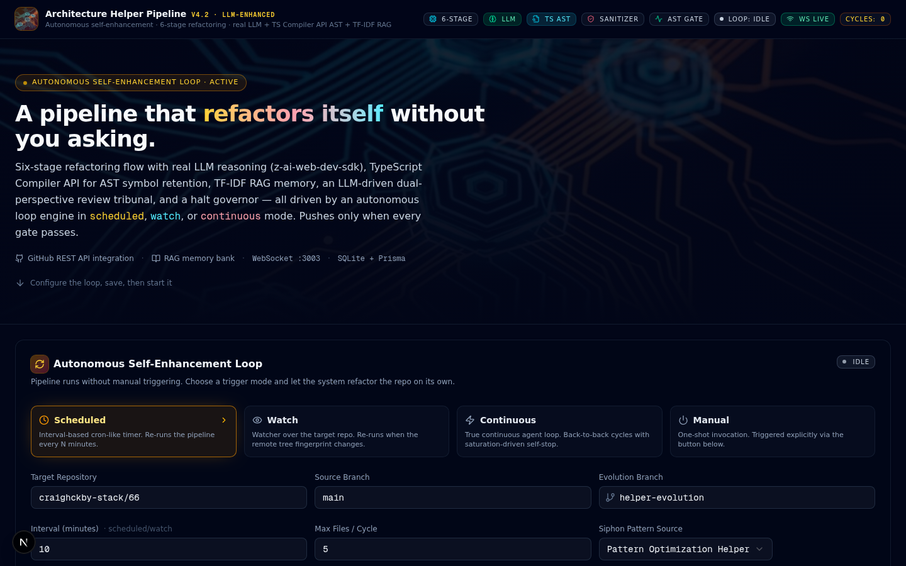
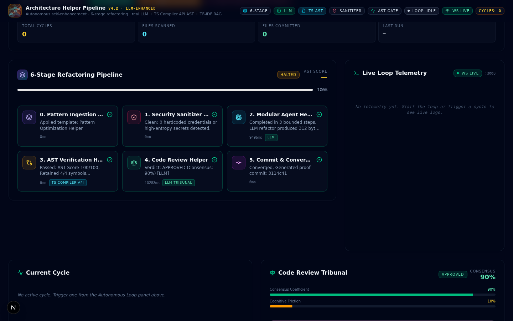
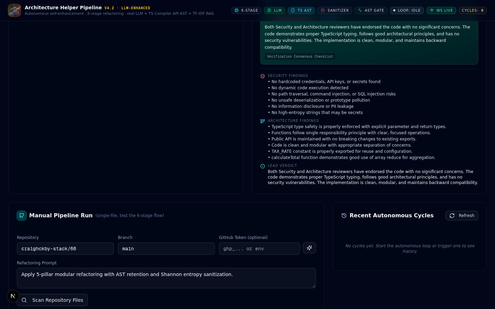

# Architecture Helper Pipeline v4.2 — LLM-Enhanced Autonomous Refactoring

> An autonomous code refactoring pipeline that refactors GitHub repositories **without manual triggering**. Six-stage flow with real LLM reasoning, TypeScript Compiler API AST verification, TF-IDF RAG memory, and an LLM-driven dual-perspective review tribunal.


---

## Table of Contents

- [What It Does](#what-it-does)
- [Key Features](#key-features)
- [Live System](#live-system)
- [Screenshots](#screenshots)
- [Quick Start](#quick-start)
- [Configuration](#configuration)
- [Architecture](#architecture)
- [The 6-Stage Pipeline](#the-6-stage-pipeline)
- [Autonomous Loop Modes](#autonomous-loop-modes)
- [API Reference](#api-reference)
- [Honest Limitations](#honest-limitations)
- [Tech Stack](#tech-stack)
- [License](#license)

---

## What It Does

The Architecture Helper Pipeline is a self-enhancing code refactoring system. You point it at a GitHub repository, and it:

1. **Fetches** the repo's file tree via the GitHub REST API
2. **Selects** real code files (`.ts`, `.tsx`, `.js`, `.py`, `.go`, `.rs`, `.java`, etc.)
3. **Runs a 6-stage pipeline** on each file:
   - Pattern ingestion → Shannon entropy sanitization → **real LLM refactoring** → TypeScript Compiler API AST verification → **LLM debate tribunal** → convergence + proof hash
4. **Commits** the refactored code to an evolution branch (auto-created if it doesn't exist)
5. **Repeats** on a schedule, watch, or continuous basis — without you asking

The system **only commits when every gate passes**: AST symbol retention ≥ 50, review tribunal approves, and the halt governor doesn't flag 0-diff saturation. This means it won't push broken refactors or cosmetic-only changes.

---

## Key Features

- **Real LLM Reasoning** — Stage 2 uses `z-ai-web-dev-sdk` to actually refactor code (add type annotations, extract constants, modularize). Not a stub.
- **TypeScript Compiler API AST** — Stage 3 uses `ts.createSourceFile` to walk the real AST and verify symbol retention. Catches nested scopes, arrow functions, re-exports, methods, enums, namespaces.
- **LLM Debate Tribunal** — Stage 4 runs 3 real LLM calls (Security Reviewer + Architecture Reviewer in parallel, then Lead synthesis). Falls back to rule-based if the LLM is unavailable.
- **TF-IDF RAG Memory** — Pattern memory bank uses term frequency–inverse document frequency with cosine similarity, not token-overlap counting.
- **4 Autonomous Trigger Modes** — Scheduled, Watch, Continuous, Manual.
- **Real-time Telemetry** — WebSocket mini-service on port 3003 streams loop state to the browser via Socket.IO.
- **Self-Stopping Governor** — Halts on 0-diff saturation, max cycles, or 3 consecutive failures.
- **SQLite Persistence** — Pipeline runs, autonomous cycles, and memory entries persist across restarts.
- **Skip-Already-Committed Logic** — Each cycle processes NEW files instead of re-doing the same first-N-alphabetical files.
- **Branch Auto-Creation** — The evolution branch is created from the source branch HEAD if it doesn't exist.
- **Token-Safety** — Empty-string and `[REDACTED]` placeholders never leak as real tokens.

---

## Live System

The system is deployed and running. The dashboard is available at:

**[→ Open the Architecture Helper Pipeline Dashboard](/)**

> The dashboard runs on port 3000 (Next.js) with a WebSocket telemetry service on port 3003. Both are wired through the Caddy gateway so you can access everything from a single origin.

When you open the link, you'll see the live dashboard with:
- The autonomous loop control panel (top)
- The 6-stage pipeline visualization (middle)
- Live telemetry streaming from the WebSocket (right)
- The Code Review Tribunal (lower middle)
- The Memory Bank / RAG (bottom)

The "ws live" badge in the header confirms the WebSocket is connected. The "Token: set" / "Token: missing" badge shows whether the system can commit to GitHub.

---

## Screenshots

### 1. Hero + Autonomous Loop Control Panel

The landing view: hero section with the system description, followed by the centerpiece — the Autonomous Self-Enhancement Loop control panel with 4 trigger mode cards, repo config, and Start/Stop/Trigger buttons.



### 2. 6-Stage Pipeline (Live)

The 6-stage refactoring pipeline visualization with real data. Each stage shows its status (pending/running/succeeded/blocked), duration, and contextual badges:
- Stage 2 shows a green **LLM** badge when the real LLM was used
- Stage 3 shows a **TS Compiler API** badge (or "Regex fallback" for non-TS files)
- Stage 4 shows **LLM Tribunal** or **Rule-based** depending on which reviewer ran



### 3. Code Review Tribunal (Live)

The dual-perspective review tribunal with actual LLM-generated arguments from the Security Reviewer, Architecture Reviewer, and Lead Reviewer. Shows consensus coefficient, cognitive friction, and per-reviewer findings.



### 4. Full Dashboard Overview

A full-page capture showing all sections in context: hero, loop control, pipeline stages, live telemetry, current cycle, debate tribunal, recent cycles, manual runner, and memory bank.


---

## Quick Start

### Prerequisites

- **Node.js 22+** or **Bun** (recommended — this project uses Bun)
- A GitHub account (for the autonomous loop to push commits)
- A GitHub personal access token with `repo` scope (set via UI or env)

### Install & Run

```bash
# Clone the repo
git clone https://github.com/YOUR_USERNAME/architecture-helper-pipeline.git
cd architecture-helper-pipeline

# Install dependencies
bun install

# Initialize the SQLite database
bun run db:push

# Start the Next.js dev server (port 3000)
bun run dev

# In a separate terminal, start the WebSocket telemetry service (port 3003)
cd mini-services/loop-ws-service
bun install
bun run dev
```

Open `http://localhost:3000` in your browser. You'll see the dashboard.

### Set Your GitHub Token

To actually push commits to GitHub, you need a token:

1. Go to **https://github.com/settings/tokens**
2. Generate a new classic token with `repo` scope
3. In the dashboard, find the **GitHub Token** field in the Loop Control Panel
4. Paste your token and click **Save Configuration**

The "Token: set" / "Token: missing" badge tells you when commits can happen.

---

## Configuration

### Via the UI

The Loop Control Panel exposes all config:
- **Mode**: Scheduled / Watch / Continuous / Manual
- **Target Repository**: `owner/repo` (e.g. `craighckby-stack/rea`)
- **Source Branch**: e.g. `main`
- **Evolution Branch**: e.g. `helper-evolution` (auto-created if missing)
- **Interval (minutes)**: for scheduled/watch modes
- **Max Files / Cycle**: up to 500 (hard cap)
- **Siphon Pattern Source**: 6 built-in architectural templates
- **Refactoring Prompt**: passed to the LLM
- **GitHub Token**: stored server-side, never displayed after saving
- **Auto-Push**: toggle commit dispatch

### Via Environment Variables

Add to `.env`:

```env
DATABASE_URL="file:./db/custom.db"
GITHUB_TOKEN=ghp_your_real_token_here
BINARY_SHIELD_SEED=your_custom_crypto_seed
```

`GITHUB_TOKEN` is the fallback when no token is set via the UI.

---

## Architecture

```
┌─────────────────────────────────────────────────────────────┐
│                    Browser (Dashboard)                       │
│  ┌───────────────────────────────────────────────────────┐  │
│  │  React UI (Next.js 16 App Router)                     │  │
│  │  ├── Loop Control Panel                                │  │
│  │  ├── 6-Stage Pipeline Visualization                   │  │
│  │  ├── Live Telemetry (Socket.IO client)                │  │
│  │  ├── Code Review Tribunal                              │  │
│  │  ├── Manual Pipeline Runner                           │  │
│  │  └── Memory Bank (RAG) Display                        │  │
│  └───────────────────────────────────────────────────────┘  │
└───────────────────────────┬─────────────────────────────────┘
                            │ WebSocket (port 3003 via gateway)
                            ▼
┌─────────────────────────────────────────────────────────────┐
│              WS Mini-Service (port 3003)                     │
│  Polls /api/autonomous/status every 1s                      │
│  Broadcasts "state" events to all connected clients         │
└───────────────────────────┬─────────────────────────────────┘
                            │ HTTP poll
                            ▼
┌─────────────────────────────────────────────────────────────┐
│              Next.js Server (port 3000)                      │
│  ┌───────────────────────────────────────────────────────┐  │
│  │  Autonomous Loop Runtime (singleton)                   │  │
│  │  ├── scheduled / watch / continuous / manual modes     │  │
│  │  ├── halt governor (0-diff, max-cycles, consec-fail)   │  │
│  │  └── previouslyCommittedPaths (skip already-done)     │  │
│  └───────────────────────────────────────────────────────┘  │
│  ┌───────────────────────────────────────────────────────┐  │
│  │  6-Stage Pipeline Runner                               │  │
│  │  0. Pattern Ingestion (siphon.ts)                      │  │
│  │  1. Shannon Entropy Sanitizer (sanitizer.ts)          │  │
│  │  2. LLM Refactorer (z-ai-web-dev-sdk)                 │  │
│  │  3. AST Diff Gate (TypeScript Compiler API)           │  │
│  │  4. LLM Debate Tribunal (3 LLM calls)                 │  │
│  │  5. Convergence + Proof Hash (BinaryShield)           │  │
│  └───────────────────────────────────────────────────────┘  │
│  ┌───────────────────────────────────────────────────────┐  │
│  │  SQLite (Prisma)                                       │  │
│  │  ├── PipelineRun (every pipeline execution)            │  │
│  │  ├── AutonomousCycle (every loop cycle)                │  │
│  │  └── MemoryEntry (RAG pattern bank)                   │  │
│  └───────────────────────────────────────────────────────┘  │
└───────────────────────────┬─────────────────────────────────┘
                            │ HTTPS
                            ▼
┌─────────────────────────────────────────────────────────────┐
│              GitHub REST API                                 │
│  - Tree fetch (GET /repos/{owner}/{repo}/git/trees/{branch}) │
│  - File fetch (GET /repos/{owner}/{repo}/contents/{path})    │
│  - Branch creation (POST /repos/{owner}/{repo}/git/refs)      │
│  - File commit (PUT /repos/{owner}/{repo}/contents/{path})   │
└─────────────────────────────────────────────────────────────┘
```

---

## The 6-Stage Pipeline

| Stage | Name | What It Does | Implementation |
|-------|------|--------------|----------------|
| 0 | Pattern Ingestion | Selects an architectural template based on file type and content | `siphon.ts` — rule-based pattern vote |
| 1 | Security Sanitizer | Computes Shannon entropy, redacts secrets (API keys, PII, high-entropy strings) | `sanitizer.ts` — real regex + entropy math |
| 2 | Modular Agent Helper | **Real LLM refactoring** — produces refactored code | `clean-room-runtime.ts` + `agent-llm.ts` — z-ai-web-dev-sdk |
| 3 | AST Verification | Verifies symbol retention, detects branding injection, checks structural drift | `ast-diff-gate.ts` — TypeScript Compiler API |
| 4 | Code Review Tribunal | **3 LLM calls**: Security Reviewer + Architecture Reviewer (parallel), then Lead synthesis | `debate-llm.ts` — falls back to rule-based |
| 5 | Convergence & Proof | Halt governor checks, SHA-256 proof hash, RAG memory entry | `halt.ts` + `binaryShield.ts` + `emg-rag.ts` |

**Gate logic:** A commit is dispatched only when:
- AST gate passed (score ≥ 50, no high-severity violations)
- Review tribunal consensus is APPROVED or CONDITIONAL_APPROVAL
- Halt governor did not halt (or halted only on 0-diff saturation, which means "nothing to commit")
- Auto-Push is enabled
- A GitHub token is configured
- The file hasn't already been committed in a prior cycle

---

## Autonomous Loop Modes

### Scheduled (default)
Interval-based cron-like timer. Re-runs the pipeline every N minutes (configurable, default 10). Best for steady, rate-limit-friendly progress.

### Watch
Polls the target repo's tree fingerprint every N minutes. Re-runs only when the remote tree changes. Skips the cycle if nothing changed. Best for repos that change infrequently.

### Continuous
True continuous agent loop. Back-to-back cycles with a 1.5s cooldown between cycles. The halt governor stops the loop when 0-diff saturation or consecutive failures occur. Best for fast initial processing of large repos.

### Manual
One-shot invocation. Triggered explicitly via the UI button or `/api/autonomous/trigger`. Best for testing and demos.

---

## API Reference

All routes are under `/api/` and return JSON. All POST routes accept JSON bodies.

### Health
- `GET /api/health` — System health, version, enhancement list, loop stats

### Autonomous Loop
- `GET /api/autonomous/status` — Current loop state, config, stats, logs, recent cycles
- `POST /api/autonomous/config` — Update loop config (mode, repo, branch, token, etc.)
- `POST /api/autonomous/start` — Enable the loop
- `POST /api/autonomous/stop` — Disable the loop
- `POST /api/autonomous/trigger` — Trigger a one-shot manual cycle
- `GET /api/autonomous/recent-cycles` — Recent cycle history

### Pipeline
- `POST /api/pipeline/run` — Run the 6-stage pipeline on a single file (manual)
- `GET /api/pipeline/history` — Recent pipeline runs from the DB

### GitHub
- `POST /api/github/validate-token` — Validate a GitHub token
- `POST /api/github/repo-tree` — Fetch a repo's file tree
- `POST /api/github/fetch-file` — Fetch a single file's content
- `POST /api/github/commit-file` — Commit a single file
- `POST /api/github/batch-commit` — Batch-commit multiple files

### Analysis
- `POST /api/emg/sanitize` — Run the Shannon entropy sanitizer on code
- `POST /api/evolution/debate` — Run the LLM debate tribunal on code
- `POST /api/evolution/coherence-gate` — Check structural drift ratio
- `GET /api/engines/catalog` — List the 6 siphon pattern sources
- `GET /api/memory/entries` — List all RAG memory entries
- `GET /api/memory/query?q=<text>` — TF-IDF ranked query against the memory bank

---

## Honest Limitations

This section is here because the system has been honestly assessed and the limitations matter.

- **No behavior preservation check** — The AST gate verifies *symbol* retention, not *behavior*. The LLM could swap `a + b` for `a - b` (changing behavior) and the AST gate would pass because both `add` functions are still present. There's no test execution or type check.
- **Watch mode is polling** — Not `fs.watch`. It polls the GitHub tree API every N minutes and compares fingerprints. Same latency as scheduled, just with a skip-if-unchanged optimization.
- **TF-IDF RAG has few seed entries** — Only 6 built-in patterns. With so few entries, IDF flattens out and ranking differences between queries are small. Add more entries via the pipeline (every run adds one) or via the DB.
- **LLM can produce nonsense on non-code files** — The file filter excludes markdown/JSON/YAML, but if you bypass it (via the manual runner), the LLM will happily "refactor" a README by adding TypeScript comment headers.
- **0-diff saturation may flag useful refactors** — If the LLM's refactor is mostly comments (e.g. adding JSDoc), `normalizeCode` strips comments and the saturation check sees no semantic change. Useful comment additions get discarded.
- **Singleton state clears on server restart** — The loop config, token, and `previouslyCommittedPaths` are in-memory. A dev server restart wipes them. Set `GITHUB_TOKEN` in `.env` to survive restarts.
- **GitHub rate limits** — 5,000 req/hour authenticated, 60/hour anonymous. Each cycle does ~2 API calls per file. At 100 files/cycle, that's ~200 calls — you can do ~25 cycles/hour before hitting the limit.
- **No PR mode** — Commits go straight to the evolution branch. There's no "open a PR" option. You'd merge the evolution branch manually.

---

## Tech Stack

| Layer | Technology |
|-------|-----------|
| Framework | Next.js 16 (App Router) |
| Language | TypeScript 5 |
| Styling | Tailwind CSS 4 + shadcn/ui (New York) |
| Database | Prisma ORM + SQLite |
| Real-time | Socket.IO (port 3003 mini-service) |
| LLM | z-ai-web-dev-sdk (server-only) |
| AST | TypeScript Compiler API (`ts.createSourceFile`) |
| RAG | TF-IDF + cosine similarity (custom) |
| Crypto | Node `crypto` (AES-GCM, SHA-256) |
| State (client) | Zustand |
| Icons | lucide-react |
| Animations | framer-motion |

---

## License

MIT — inherited from the original `craighckby-stack/66` project.

---

## Acknowledgements

Built as a re-implementation and enhancement of the [Architecture Helper Pipeline v4.0](https://github.com/craighckby-stack/66) originally by `craighckby-stack`. The v4.2 enhancement replaces the original stubbed stages with real LLM reasoning, real TypeScript Compiler API AST parsing, real TF-IDF RAG, and an LLM-driven debate tribunal — while preserving the original's 5-Pillar Clean-Room architecture, halt governor, and dual-perspective review concept.
