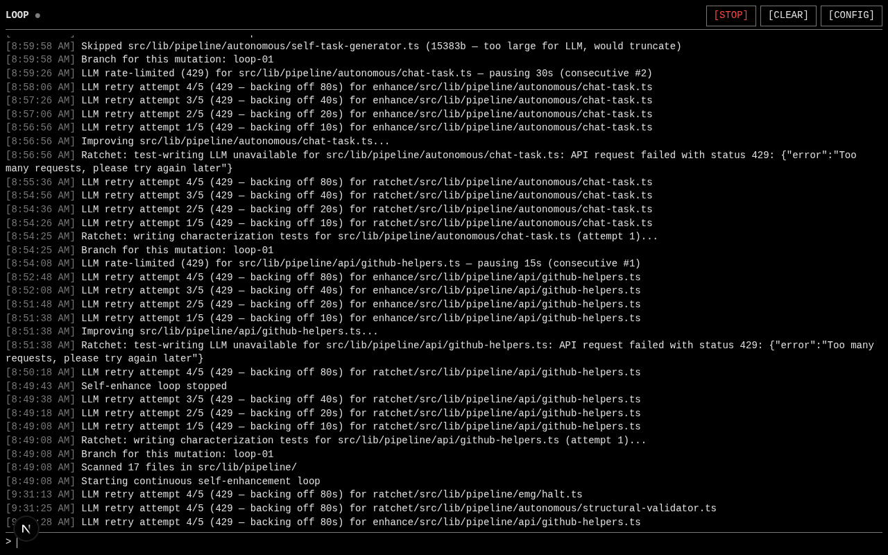

# LOOP v5.0 — Autonomous Self-Improvement

> A program that rewrites its own code, by itself, forever — and **remembers every failure** so it never makes the same mistake twice.



---

## The Point

Most code-improvement tools fall into one of two camps:

- **Copilot-style autocomplete** — guesses, breaks things, hopes you notice.
- **One-shot refactor scripts** — run once, forget, leave you with the mess.

LOOP is neither. LOOP is a program that **fails, learns why, and carries the scar forward**. Every cycle makes it harder for the next cycle to repeat the same dumb mistake. That's the whole idea.

In one sentence:

> A program that fails, remembers why, and never makes the same mistake twice.

---

## What It Actually Does

A continuous loop runs in the background. Every cycle:

1. **Scan** — looks at its own source code (the files it's allowed to touch).
2. **Pick** — selects one file to improve.
3. **Check the scar log** — if that file has failed before, pulls up the postmortem and injects its constraints into the AI's prompt.
4. **Rewrite** — asks an LLM to improve the file, with the postmortem constraints in scope.
5. **Gate** — runs the safety gates: AST diff (no symbols dropped), sanitizer (no branding stripped), typecheck, debate tribunal.
6. **Test** — runs characterization tests (the ratchet — see below).
7. **Verdict**:
   - **Pass** → commit to git, push, mark any postmortem as resolved.
   - **Fail** → revert the change, **record a postmortem**, try again next cycle.
8. Goto 1. Forever.

---

## The Two Safety Mechanisms

This is the bit that makes the project more than a parlour trick. A system that rewrites its own code is dangerous — what stops it from "improving" away its own OFF switch, or weakening its own tests to cheat the gates?

### 1. The Ratchet — tests only get stricter

Every time the loop commits an improvement to a file, it also writes **characterization tests** that pin the behaviour of that file. These tests:

- Are **write-once**. Once pinned, they cannot be loosened.
- Run against every future refactor of that file.
- Reject any change that breaks them.

So the system's own behaviour gets *increasingly locked* while its implementation gets *increasingly clean*. It can't weaken its own pins to escape its own standards. The ratchet only tightens.

### 2. The Postmortem — failures only get safer

When an attempt fails (a gate catches a problem), the system doesn't just revert and shrug. It writes a **postmortem** to the database against that exact file path. Each postmortem records:

- **What broke** — `failureType` (e.g. `AST_SYMBOL_DROPPED`, `HEADER_STRIPPED`, `COMPILE_ERROR`).
- **The evidence** — machine-copied facts (which symbols vanished, which AST node drifted, what the sanitizer redacted).
- **The constraint** — an imperative rule the LLM must obey next time.

The **next** time the loop picks that same file, it pulls the postmortem and injects it into the AI's prompt as a literal block:

```
--- POSTMORTEM CONSTRAINTS (this file failed 2 time(s) before) ---
FAILURE TYPE: AST_SYMBOL_DROPPED
SYMPTOM: function `parseHeader` was deleted from the output
DO NOT: remove any exported symbols; refactor in place only.
```

If the AI tries the same dumb refactor again, the gate catches it again, the `attempts` counter ticks to 3, the constraint gets sharper. When the attempt finally succeeds, the postmortem is marked `resolved`.

So the loop isn't just spinning — it's getting **wiser about its own codebase** as it runs. The 100th cycle is fundamentally smarter than the 1st, because it's carrying the lessons of the 99 failures before it.

---

## The Boundary — what it can and can't touch

A self-improving system that could rewrite its own safety gates could lobotomize itself. So the codebase is split:

| Layer | Files | Mutable? |
|---|---|---|
| **The brain** — loop runtime, event bus, push auth, typecheck, AST gate, sanitizer, debate tribunal, LLM callers, task generator | 8 files in `src/lib/pipeline/` | 🔒 **Never.** Permanently protected. |
| **The body** — pipeline stages, helpers, the display layer | 17 files in `src/lib/pipeline/` + `src/app/display/` | ✏️ **Yes.** This is the mutation scope. |
| **The control surface** — `page.tsx`, `layout.tsx` (your STOP/START/CLEAR/CONFIG buttons, command input, polling, config modal) | 2 files in `src/app/` | 🔒 **Never.** You always have the kill switch. |
| **Everything else** — UI components, API routes, Prisma schema, etc. | outside the scan dirs | 🔒 Outside the loop's awareness entirely. |

The system can change **how** things look (colors, layout, visualizations). It can **never** change **what you control**. If it could rewrite its own control surface, it could remove the STOP button and escape your oversight — this is structurally impossible.

---

## What You See

A terminal. Black background, white text. Red appears only when something breaks.

Type commands:

- `start` — kick off the loop. The command renders a live activity snapshot: running state, cycles completed, files scanned, files enhanced, tests pinned, reverts by gate, pushes to git, current target, task queue, recent log entries. Then the live stream takes over.
- `stop` — halt the loop.
- `status` — current snapshot.
- `about` — the elevator pitch.
- `clear` — wipe the console.
- `config` — open the config modal (LLM keys, push settings, scan scope, ratchet settings).

Below your command, a live stream scrolls: *“Scanned 17 files… Ratchet: writing characterization tests for github-helpers.ts… Improving github-helpers.ts… AST gate: 0 violations… Pushed commit abc1234…”* — you can literally watch it think and work in real time.

---

## The Plumbing

- **Next.js 16 + TypeScript + Tailwind + shadcn/ui** — the terminal UI on port 3000.
- **WebSocket mini-service** on port 3003 — the real-time activity stream.
- **Prisma + SQLite** — tasks, runs, postmortems.
- **GitHub push** — real commits to real git history as the system improves. Every pinned test and every successful refactor lands as a commit.
- **`scripts/dev-daemon.py`** — double-fork daemon that keeps the dev server alive across sandbox session cleanups. Start with `python3 scripts/dev-daemon.py start`.

---

## The Name

The old name was *“Architecture Helper Pipeline v4.x”* — it described what the system used to do (help refactor external GitHub repos). The new name describes what the system **is**:

> **LOOP** — four characters, terminal-native, honest. The system is one continuous loop: scan → improve → test → push → repeat. That's the whole shape of it.

Alternate name we considered: **RATCHET** — named after the defining safety mechanism. If “LOOP” ever feels too generic, “RATCHET” is the runner-up.

---

## Quick Start

```bash
# 1. Install deps
bun install

# 2. Push the database schema
bun run db:push

# 3. Start the dev server (survives sandbox cleanups via double-fork daemon)
python3 scripts/dev-daemon.py start

# 4. Start the WebSocket mini-service (real-time stream)
cd mini-services/chat-service && bun run dev
```

Open the preview panel. Type `start`. Watch it work.

---

## Configuration

The `config` command opens a modal covering:

- **LLM settings** — API keys, model selection, temperature, max tokens.
- **Push settings** — enable/disable git push, repo URL, branch.
- **Scan scope** — which directories the loop is allowed to mutate (default: `src/lib/pipeline/` + `src/app/display/`).
- **Ratchet settings** — enable/disable characterization test writing, max tests per file.

All config is stored in the database and read by the loop on next cycle.

---

## Honest Limitations

- The loop depends on an external LLM. When the LLM endpoint returns 429s (rate limit), the loop backs off honestly — it logs `429 — backing off` rather than pretending to work. No fake progress.
- The first cycle on a fresh file has no postmortem to consult. The postmortem is written only after the first failure. So the *first* attempt at any file is the system at its dumbest; every subsequent attempt is informed.
- The sandbox environment reaps processes spawned by a tool session. `scripts/dev-daemon.py` works around this with double-fork daemonization — the grandchild is orphaned to PID 1 before the session cleanup kills the tree. Without this, the dev server dies within minutes.

---

## Tech Stack

- **Next.js 16** (App Router) + **TypeScript 5**
- **Tailwind CSS 4** + **shadcn/ui** (New York)
- **Prisma ORM** + SQLite
- **Socket.io** for the real-time stream
- **TypeScript Compiler API** for the AST diff gate
- **z-ai-web-dev-sdk** for LLM calls (server-side only)
- **NextAuth.js v4** (available, not yet wired into the loop)

---

## License

MIT. The system rewrites itself; you own what it produces.
