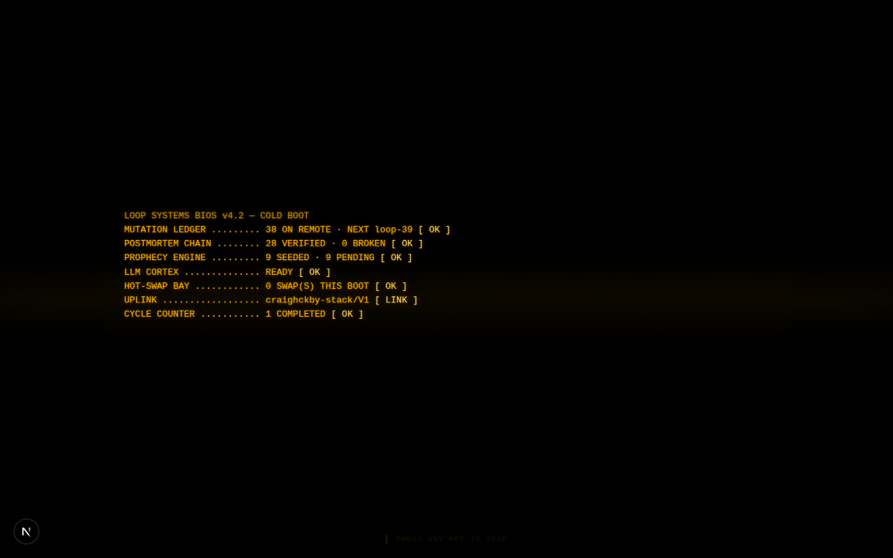
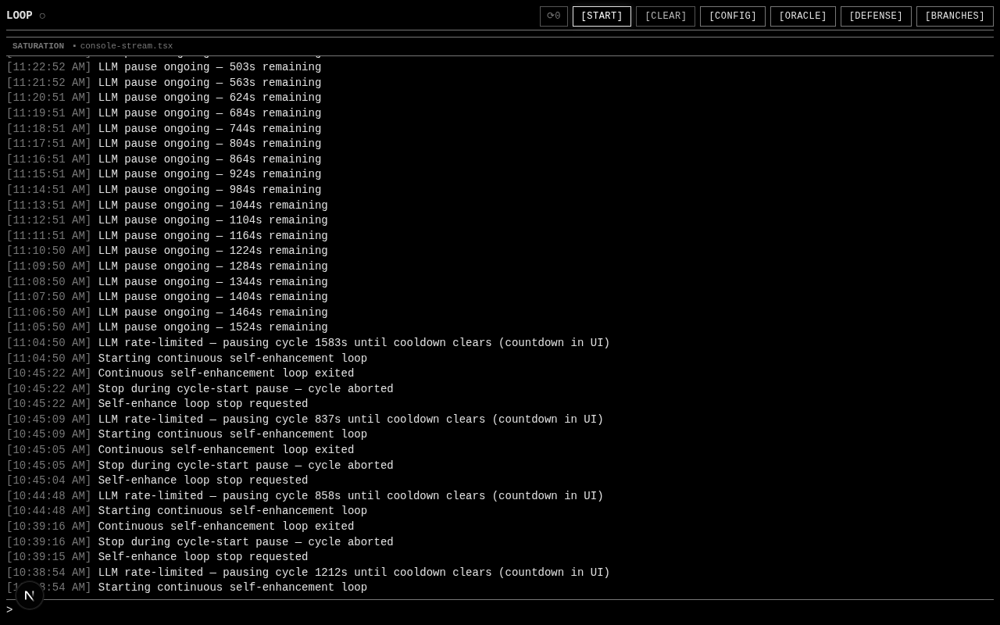
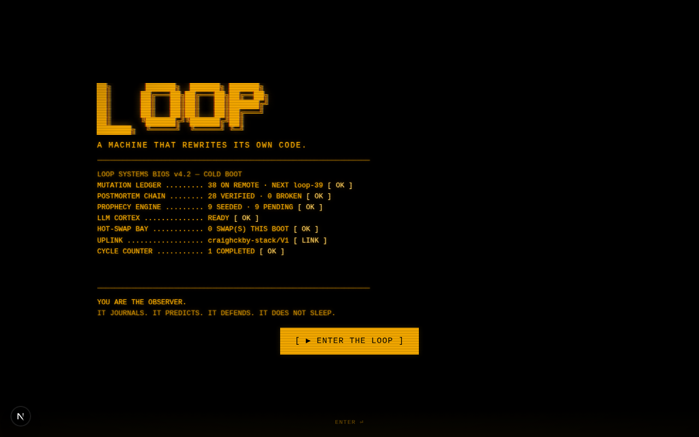
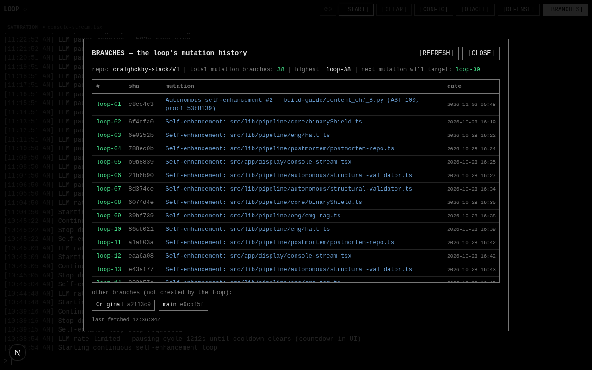
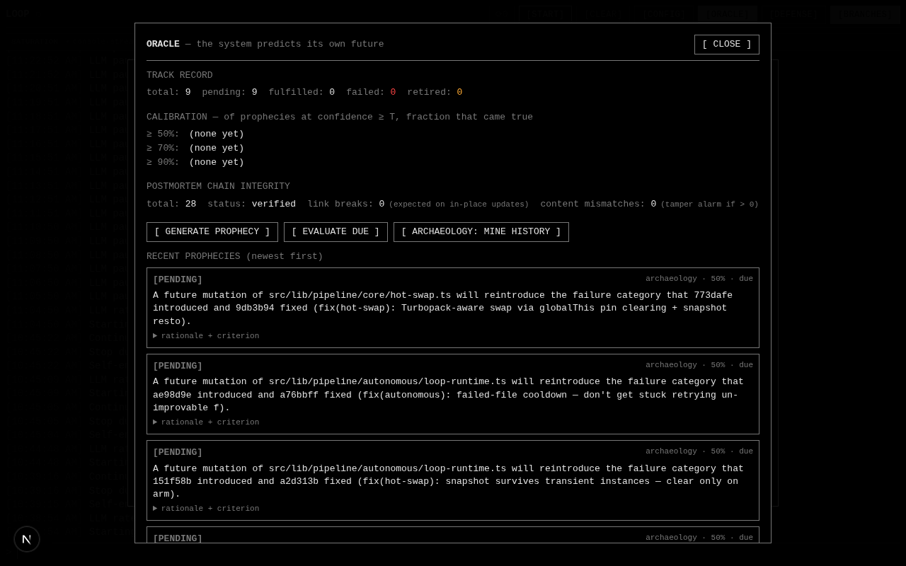
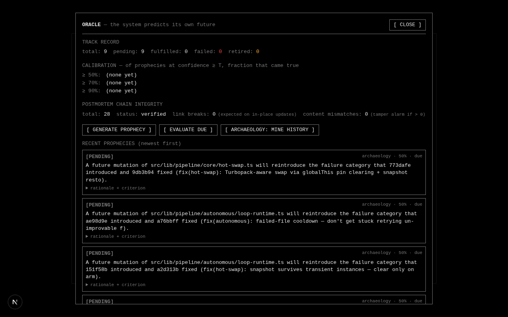

plateaued at 0.7% yield after 900 cycles

# LOOP

> A Next.js app that **reads its own source code, asks an AI to improve one file at a time, runs every proposed change through a compiler + AST + debate gate chain, and pushes the survivors to GitHub** as one `loop-NN` branch per winning mutation. Failures become postmortems that constrain the next attempt. The loop can't rewrite its own OFF switch.



---

## ⏱ THE 10-DAY ENDURANCE TEST (2026-11-24 → 2026-12-04)

**This system is currently mid-test.** The question this run answers, in one
sentence:

> **How long can a self-improving system keep running — online and offline —
> with ZERO operator interaction, while the operator closes the browser,
> goes to sleep, and the network drops in and out?**

The purpose (from the operator's framing when the run was sanctioned): not
throughput, not yield — **autonomy**. The loop must keep cycling, keep
mutating, keep committing, keep pushing, and — critically — keep *not dying*
for 10 straight days. Every failure mode that would silently halt the run
has been pre-empted with a supervision layer or an offline-parity behavior.
If the run ends early, it must end LOUDLY (a deliberate safe-stop), never as
a silent wedge nobody noticed.

**Rules of the run:**

- **No operator interaction for 10 days.** The operator may observe the
  dashboard, but the system must never *require* them. Supervision is
  delegated to cron delegates (below).
- **Online and offline.** The network may drop for minutes or hours. An
  outage degrades the loop (idle cycles, local commits, deferred pushes) —
  it never halts it. See "Offline parity" below.
- **Nothing is lost.** Verified mutations commit locally even when pushes
  defer; per-branch pushes are HEAD-based, so deferred commits ride the
  first successful push after recovery. Durable state lives in wipe-proof
  tiers (`.git/info/`).
- **Baseline at start (2026-11-24):** 1382 cycles · 812 enhanced · 792
  pushed · 1027 reverted · 25 tests written. The daily digest reports
  deltas against this.

**The supervision stack (why the operator can walk away):**

| Layer | Cadence | What it does |
|---|---|---|
| dev-watchdog `:3005` (in-sandbox) | 30s | probes dev-server + worker, respawns them (budget 12/hr), memory-guard |
| cron: LOOP stack heartbeat | every 8h | feeds the dead-man's switch, respawns watchdog + worker, stall check (cycle-delta) |
| cron: daily operator digest | 09:00 Brisbane | 24h deltas, worker restarts, freeze/offline state — the run's diary |
| cron: dev-server keepalive | every 10 min | outer backstop for the watchdog itself |
| dead-man's switch | 24h no-touch | the failsafe: if EVERY cron layer dies, the loop ARMED-PAUSES safely (loud, not silent) |

**Offline parity (2026-11-24, operator change):** before this change, a
network outage was fatal within ~5 mutations — every failed push counted
toward the 5-strike push-failure circuit breaker, which raises SAFE-MODE
and halts the loop for an operator. Now:

- **Network errors are exempt from the breaker** (`net-status.ts`): a
  DNS/refused/timeout push failure is classified as *deferred*, not
  *failed*. Real git wedges (auth, divergence, corruption) still trip it.
- **3 consecutive network failures → OFFLINE mode:** cycles idle (no doomed
  LLM calls), deterministic SelfTasks still apply + commit locally, pushes
  go commit-only (no 60s timeouts burned), and a ≤4s probe retries on a
  backing-off schedule (15s → 5min) until the network returns. Recovery is
  automatic and logged.
- **The dashboard shows an amber OFFLINE banner** (degraded-but-alive, not
  red), and `/status` exposes the full `net` block so the heartbeat can
  tell "offline but alive" (cycles advancing) from a genuine stall
  (cycles flat).

**What success looks like on 2026-12-04:** ten daily digests telling a
continuous story; no intervention required; the loop either still running,
actively idling through an outage, or deliberately ARMED-PAUSED by a safety
system (dead-man/crash-wall) — never wedged, never silent, nothing lost.

---

## This README is self-referential

This document is written for **two readers**:

1. **The human operator** — the person who runs LOOP, configures the PAT, reads the audit findings, and decides what to build next.
2. **The loop itself** — the autonomous self-enhancement system this document describes. The loop can read this README as part of its system-direction context (via the `provenance` command on itself, or a future `read-readme` hook). The README is a protected file — the loop can't rewrite its own documentation — but it CAN read it, and the structure below is designed to be machine-parsable so a future cycle could ingest the "what LOOP is" summary into its own prompt.

The honest framing: this is not the loop becoming sentient of its own docs. It's the docs being **shaped so the system they describe can read them** — a closed loop between the documentation and the documented. The loop's `provenance src/README.md` command already shows the README's own change history (every operator edit, every audit). A future step could inject the README's summary block (below) into the enhance prompt as system-direction context, so the loop mutates with the awareness of "what I am."

### Machine-readable summary (for the loop + the operator)

```yaml
# LOOP — self-description (machine-parsable)
identity: "A self-improving Next.js app that rewrites its own source code"
architecture:
  framework: "Next.js 16 App Router + React 19 + TypeScript 5"
  database: "Prisma 6 + SQLite (12+ models)"
  llm: "z-ai-web-dev-sdk (primary), Gemini (optional), NVIDIA NIM (optional tier-1)"
  side_processes: ["loop-ws-service:3003", "loop-worker:3004", "dev-watchdog:3005", "fleet-harvester:3010"]
core_cycle:
  - "scan own source for issues"
  - "pick a non-protected file (bandit-scored)"
  - "build context (9 blocks: postmortem, ancestral, priorArt, lessons, rejected, archContext, provenance, operating, mutationPolicy)"
  - "mutation policy steers the transform KIND (learned, two-tier)"
  - "LLM proposes one focused improvement"
  - "gate chain: mutation-guard → structural → AST → typecheck → sandbox-test → debate → secret-scan"
  - "pass: commit + push to loop-NN branch. fail: write postmortem + feed lesson"
  - "repeat forever (bounded by crash-wall, dead-man's switch, quota gate, [STOP])"
safety:
  protected_files: "59 exact paths + 18 prefix subtrees (the loop's own brain is off-limits to itself)"
  mutation_guard: "synchronous fail-closed: eval, child_process, path-traversal, MD5/SHA1, protected-path"
  dead_mans_switch: "24h without operator touch → ARMED-PAUSED"
  crash_wall: "3 consecutive same-class crashes → ARMED-PAUSED"
  quota_gate: "429 escalation: 2/5/15/30min cooldowns"
  offline_mode: "network outage → 3-strike tripwire → idle cycles + local commits + probe backoff (15s→5min); network push failures exempt from the 5-strike breaker; recovery automatic"
alive_behaviors:
  curiosity_drive: "flag-gated (default OFF); when overconfident + health flat, boosts unpredictable files"
  health_metrics: "snapshot every 10 cycles (test/tsc/lint counts)"
  operator_questions: "loop poses yes/no (health DECLINING, goal-review tie, curiosity first-fire); operator answers"
auditability:
  provenance: "per-file timeline (git + mutations + postmortems + gauntlet + lessons) — who changed what, when"
  benchmark: "A/B over the mutation corpus — does the complexity earn its keep?"
  dropbox: "external-system learning (dropbox/<system>/ → candidate lessons, bandit-scored)"
  autofork: "curated reference-repo learning (autofork-seeds.json → candidate lessons, any language)"
  mutation_policy: "learned transform prior (own gates + wild fleet archive) — `policy` command"
honest_limitations:
  - "the core intelligence is still an LLM call; the mutation policy is a learned PRIOR over transform kinds, not learned code generation"
  - "the pass-rate trend is the honest signal (the benchmark measures it)"
  - "the postmortem chain is the system vouching for itself (no external verification)"
  - "the wild tier is single-repo-dominant (ragflow) — borrowed evidence, confounders declared"
  - "single-operator, single-instance, SQLite — research system, not production"
self_rating: "7/10 (novel self-reference + thoughtful trust model + first learned component; held back by scale + research-grade ML + outsourced core generation)"
endurance_test:
  window: "2026-11-24 → 2026-12-04 (10 days, Australia/Brisbane)"
  mode: "unattended — cron delegates supervise (heartbeat 8h, digest daily 09:00, dev-watchdog 30s); dead-man's switch is the loud failsafe"
  offline_contract: "outages degrade (idle + local commits + deferred pushes), never halt; deferred commits ride the next successful push"
  baseline: "1382 cycles / 812 enhanced / 792 pushed / 1027 reverted / 25 tests"
```

---

## Start here (if you're new)

LOOP is a program that edits **its own code** while it runs — and the edits have to pass a gauntlet of automated checks before they're allowed to land. Think of it as a careful mechanic working on a car while the engine is running: it proposes a tweak, a panel of inspectors checks that the tweak doesn't break anything, and only then does the tweak get installed.

It is **not** a chatbot, and it is **not** an AGI. The AI only writes small, gated diffs to existing files. The cleverness is in the **gating** — the wall of automated checks that rejects anything broken, dangerous, or pointless — not in the generation.

**Is it safe?** Short answer: it can't turn itself off in a bad way, because it's forbidden from editing the files that control its own stopping logic, its judges, or its memory. It also stops itself after 3 crashes of the same kind, after 24 hours without a human touch, or when the AI provider rate-limits it. You can always press `[STOP]`.

**30-second analogy:** imagine a junior developer who never sleeps, working through the codebase one file at a time, proposing a single improvement, getting it code-reviewed by three senior reviewers plus a compiler plus a test suite, and only shipping if everyone agrees. Every rejection gets written up as a "postmortem" so the same mistake is never made twice. That's LOOP.

### Run it

```bash
bun install
bun run db:push
bun run dev

# In another terminal — the real-time stream mini-service
cd mini-services/loop-ws-service && bun run dev
```

Open the **Preview Panel** on the right (or click *Open in New Tab*). You'll see a 1980s-style CRT boot sequence that fetches the system's own live vitals and stamps them in. Press **ENTER** (or any key) to enter the terminal. Type `start`. Watch it work.

To make mutations land on GitHub, type `config` (or click `[CONFIG]`) and paste a classic GitHub PAT (repo scope) + `owner/repo`. The PAT is sealed at rest with AES-256-GCM the moment it lands; later boots auto-connect with zero operator input.

---

## What you'll see

A single full-screen BIOS terminal at `/` (`src/app/page.tsx`) — black background, amber phosphor text.



| | |
|---|---|
| **POST** — the boot splash fetches its own live vitals and stamps 17 honest lines (incl. the DB mutation corpus) |  |
| **Invite** — the machine asks you to enter |  |
| **Branches** — every `loop-NN` is one successful mutation |  |
| **Oracle** — predicts + grades its own operational future |  |
| **Config** — sealed-PAT push target |  |
| **Defense** — duress / red-team / secret-scan grafts |  |

**The header** has `[START]`, `[CLEAR]`, `[CONFIG]`, `[TARGET]`, `[ORACLE]`, `[DEFENSE]`, `[BRANCHES]`, `[MERGE-BACK]` buttons, plus a `LOOP ●` heartbeat.

**The console stream** (`console-stream.tsx`) shows every scan, gate, push, retry, and backoff in real time. You can also type commands: `start` / `stop` / `status` / `about` / `help` / `trigger` / `task <goal>` / `push` / `config` / `target` / `oracle` / `answer` / `provenance <file>` / `benchmark` / `policy` / `memory` / `skip` / `rescan` / `clear`.

### The TARGET panel — the machine pointed at YOUR repo

Type `target` (or click `[TARGET]`) and the same 6-stage gauntlet the machine uses on itself — sanitize → reason (LLM) → AST gate → debate tribunal — runs against **any GitHub repository you choose**: fetch a file, propose a refactor, and if it survives the gates, push it to a `<branch>-evolution` branch of that repo (never the target branch itself). Reads work anonymously on public repos; pushes need a PAT with repo scope. This is the original "rea" pipeline revived on the hardened plumbing (see `DIRECTIONS.md`, Direction 3).

### Target mode — the STRICT gate chain, one `loop-t-NN` branch per mutation

The panel runs the 6-stage remote pipeline. For the **self-parity gate chain** — the same deterministic gauntlet a self-mutation must survive — use the console subcommands:

```
target <owner/repo> [branch]   — point the loop at an external repo (reachability-verified)
target dry                     — full gate rehearsal: NOTHING lands on GitHub
target run                     — one gated mutation, committed to a fresh loop-t-NN branch
target status                  — the configured target + last-run audit trail
target off                     — disconnect
```

`target run` picks a file the same way the self-loop picks its own (same static-analysis detectors: TODOs, empty catches, `any` usage, unused imports, magic numbers, non-null assertions), generates ONE focused improvement, then runs: **mutation-guard → structural → ast-diff (strict) → syntax → secret-scan → debate tribunal**. Typecheck and sandbox tests are skipped *honestly* — an external repo has no local dependency tree — and every run says so. Rejections write postmortems into the same repo-scoped scar memory the self-loop uses, so the constraints from a failed attempt on `owner/repo/src/foo.ts` shape the next attempt on that same file. Survivors land on their own `loop-t-NN` branch (`git diff loop-t-4..loop-t-5` = exactly one improvement), never on the base branch. Implementation: `src/lib/pipeline/target/` (`target-runner.ts` is the cycle, `TARGET_PATH_POLICY` is the gate contract).

### The SATURATION panel and the `[unlock]` buttons

Near the bottom of the terminal there's a strip that looks like:

```
SATURATION  ▪prophecy-evaluator.ts(2/3)  🔒prophecy-store.ts⚠[unlock]  ▪nvidia-direct.ts  ...
```

This is the **saturation / lockout panel**. Here's how to read it:

- **`▪ filename`** — a file that's being evaluated normally. The `(2/3)` means it's had 2 consecutive "no growth" cycles; after 3 it locks.
- **`🔒 filename`** — a file that's been **locked out** for the rest of the pass. The loop won't spend AI quota on it until you unlock it (or until the server restarts, which starts a fresh pass).
- **`⚠`** next to a lock — the file is locked for a **deterministic** reason (it's too large, too small, or the self-model predicts zero diff). Unlocking it will re-lock on the next cycle **unless the underlying condition changes** (e.g. you shrink the file). The ⚠ is a warning that a bare unlock won't stick — it's not a broken button. Hover the `[unlock]` button for the exact reason.
- **`[unlock]`** — click to request a fresh start for the file (resets its no-growth counter so the loop re-evaluates it next cycle). The click **does not unlock directly** — it opens the **operator-PIN prompt** first. The PIN is printed exactly once in this README, deliberately mid-document past the sections a skimmer reads, so you only know it if you've actually read the manual. That's the point: the unlock button re-exposes locked files to mutation, and it's for operators who have read the docs, not casual passers-by. See *Why it can't go rogue → The unlock PIN*. The console stream prints the outcome (unlocked / refused / reason).
- **`🎯 PASS COMPLETE`** — every eligible file is locked out. The system has converged for this pass. Review the locks and unlock (operator PIN) the ones you want re-attempted to start a new pass.

> Why lock files at all? So the loop **converges**. Without lockout, a 40-file scope would re-review the same stable files forever, burning AI quota for no gain. Three unproductive cycles → lock → the loop moves on to files that might actually improve. It's the churn control that makes full-scope scanning affordable.

---

## How it works — the simple version

The core cycle, running in the background on the server:

1. **Scan** — the loop statically analyzes its own source code and builds a prioritized to-do list (todo-comments, empty `catch` blocks, `any` types, missing return types, unused imports, magic numbers, non-null assertions).
2. **Pick** — claim the next task. Skip any file on the protected list (the loop can never edit its own brain).
3. **Contextualize** — gather everything the AI should know: the per-file postmortem constraints, the ancestral library of every failure ever, the top lessons by trust score, and the rejected-diff block for this file.
4. **Generate** — send the file + context to the AI, asking for one improvement.
5. **Gate** — run the proposed change through a chain of checks (see the next section). If any check fails, reject.
6. **Verdict** — pass: write the file, commit, push to a fresh `loop-NN` branch. Fail: revert, write a postmortem, feed the lesson learned, try again next cycle.
7. **Repeat** — forever, bounded by the crash wall, the dead-man's switch, the AI quota gate, and your `[STOP]`.

The branch model is git-native: each successful mutation gets its own `loop-NN` branch, so `git diff loop-37..loop-38` shows exactly one enhancement. **The branch list IS the changelog** — kept to the newest 50 by the retention policy.

---

## How it works — the full version

### The gate chain (in order, every proposed change runs through all of these)

1. **Mutation guard** (`core/mutation-guard.ts`) — synchronous fail-closed triage: rejects newly-introduced `eval(`, `child_process`, `fetch(`/etc)`, `globalThis[`, path-traversal, MD5/SHA1; protected-path + scaffolding check.
2. **Structural validator** (`autonomous/structural-validator.ts`) — regex pre-gate: destructive truncation, import stripping, export drop, test deletion, license-header stripping.
3. **AST diff gate** (`core/ast-diff-gate.ts`) — TypeScript compiler API symbol extraction; detects symbol-drop, branding-injection, structural drift. Score ≥ 50 to pass.
4. **In-memory typecheck** (`autonomous/in-memory-typecheck.ts`) — full project `tsc --noEmit` with the refactored file substituted. Turbopack never sees broken code.
5. **Sandbox test** (`core/sandbox-test.ts`) — disposable `.loop-sandbox/verify-XXXX/`; the candidate never touches the live tree; isolated DB (blank when the live DB is >32 MB).
6. **Debate tribunal** (`llm/debate-llm.ts`) — 3 AI reviewers (Security / Architecture / Lead); no fallback; validated stances + consensus required.
7. **Secret scan** (`core/secret-scan.ts`) — pre-push scan of the diff + commit message for `ghp_`/`AIza`/`AKIA`/`sk-`/`xox`/private keys.

Pass all seven → strip banner comments, write the live file, commit + push to a fresh `loop-NN` branch (`push-target.ts`). Resolve any open postmortems for that file. Fail any one → revert, write a postmortem (`postmortem-store.ts`), maybe a Reflexion entry, feed the lesson outcome, try again next cycle.

### Architecture

```
                ┌─────────────────────────────────────────────────┐
                │  PAGE.TSX  (protected control surface)           │
                │   fetch /api/self-enhance/* · Socket.IO :3003    │
                │   console-stream.tsx (mutable display)           │
                └──────────────────────┬──────────────────────────┘
                                       │ HTTP (gated by middleware.ts)
                                       ▼
                ┌─────────────────────────────────────────────────┐
                │  56 API ROUTES  src/app/api/**                   │
                │  self-enhance · autonomous · oracle · postmortems│
                │  red-team · github · hot-swap · duress · emg ·   │
                │  memory · secret-scan · evolution · pipeline ·   │
                │  branches · engines · boot · health · healthz     │
                └──────────────────────┬──────────────────────────┘
                                       │
                                       ▼
   ┌─────────────────────────────────────────────────────────────────┐
   │  THE BRAIN (protected — loop can never mutate these)            │
   │  autonomous/self-enhance-loop.ts  ← THE BRAIN                    │
   │  autonomous/loop-runtime.ts       ← remote-repo variant         │
   │  autonomous/self-task-generator   ← THE INPUT LAYER             │
   │  autonomous/push-target.ts        ← 3-tier sealed-PAT push      │
   │  autonomous/protected-files.ts     ← SINGLE SOURCE: what's off  │
   │  autonomous/schema-gate.ts        ← additive-only Prisma gate   │
   │  autonomous/lesson-store.ts       ← compounding intelligence    │
   │  autonomous/verify-refactor.ts    ← child-process gate chain    │
   │  autonomous/in-memory-typecheck   ← full-project tsc --noEmit   │
   │  core/ (13 files: AST, mutation-guard, sanitizer-bridge,       │
   │         secret-scan, duress, hot-swap, sandbox-test, tree-lock) │
   │  emg/ (sanitizer, debate types, halt, emg-rag)                 │
   │  postmortem/ (store + repo + ancestral-rag)                    │
   │  red-team/ (7-probe suite + 15 gate-integrity probes)          │
   │  llm/ (agent-llm, debate-llm, gemini-direct)                   │
   │  crypto/token-vault.ts  ← AES-256-GCM PAT sealing               │
   │  engines/clean-room-runtime.ts  ← ReAct loop                    │
   └─────────────────────────────────────────────────────────────────┘
                                       │
                                       ▼
   ┌─────────────────────────────────────────────────────────────────┐
   │  PERSISTENCE                                                     │
   │  SQLite (Prisma) — 12 models                                     │
   │  postmortems/<repo>/<branch>/*.json — tamper-evident chain       │
   │  .git/info/loop-{armed,crash-budget,operator-touch,push-state,   │
   │               vault-key} — wipe-proof tiers (survive DB rollback)│
   └─────────────────────────────────────────────────────────────────┘
                                       │
                                       ▼
   ┌─────────────────────────────────────────────────────────────────┐
   │  SIDE PROCESSES                                                   │
   │  mini-services/loop-ws-service/:3003  Socket.IO state relay     │
   │  proxy/  Gemini geo-bypass on Fly.io (sgp)                        │
   │  Caddyfile :81  reverse proxy (?XTransformPort pattern)          │
   └─────────────────────────────────────────────────────────────────┘
```

### The boundary — what it can and can't touch

The loop's own brain is off-limits to itself. The single source of truth is `src/lib/pipeline/autonomous/protected-files.ts`: 36 exact paths (`PROTECTED_FILES`) + 18 prefix subtrees (`PROTECTED_PREFIXES` — all of `core/`, `emg/`, `postmortem/`, `red-team/`, `engines/`, and every control-API route subtree). `isProtectedPath` is the one predicate the scanner uses.

| Layer | Mutable? |
|---|---|
| **Brain** — loop runtime, gate chain, push auth, typecheck, AST, sanitizer, debate, LLM callers, schema gate, protected-files list itself | 🔒 Never. |
| **Control surface** — `page.tsx`, `layout.tsx`, `middleware.ts`, `src/lib/db.ts`, `src/instrumentation.ts`, `api-unlock.tsx` (auth UI), `boot-splash.tsx` (entry ceremony), `pipeline-stages.tsx` (dead display code) | 🔒 Never. |
| **Control API** — `src/app/api/self-enhance/**` (the backend of the kill switch) | 🔒 Never. |
| **Body** — `src/app/display/`, the LOOP-authored `src/components/pipeline/` panels, the non-protected `src/lib/pipeline/` helpers | ✏️ Yes. |
| **Schema** — `prisma/schema.prisma` | ✏️ Additive-only (`schema-gate.ts`). |
| **Everything else** — shadcn/ui (`src/components/ui/`), the rest of `src/` | 🔒 Outside scan scope. |

A self-improving system must not be able to rewrite its own OFF switch, its own judges, or its own memory.

> **v5 (2026-11-17) scope expansion.** `src/components/pipeline/` (the LOOP-authored display panels) was re-added to the mutation scope. It was rolled back at v4 because 88% of mutations there were convergent defensive no-ops burning quota. Two new friction layers now make it safe to re-expand: (1) the **operator-PIN gate** on every saturation `[unlock]` — a careless user can no longer mash `[unlock]` to reopen the churn (see *The unlock PIN* below); (2) the **convergent-move guard** (`mutation-guard.ts detectConvergentMove`) rejects the exact "Added input validation for `<prop>`" no-ops at the gate layer, before the debate LLM call. The 69 vendored shadcn primitives in `src/components/ui/` stay excluded (third-party code). The two control-surface components inside the re-expanded subtree (`api-unlock.tsx`, `boot-splash.tsx`) are protected individually so the loop still can't touch its own auth UI or its own boot entry.

---

## Why it can't go rogue (safety mechanisms)

| Mechanism | File | What it does |
|---|---|---|
| **Protected-files list** | `autonomous/protected-files.ts` | 36 paths + 18 prefixes the loop can never touch — including the list itself |
| **Mutation guard** | `core/mutation-guard.ts` | Synchronous fail-closed triage: newly-introduced `eval(`, `child_process`, `fetch(`, `globalThis[`, path-traversal, MD5/SHA1; protected-path + scaffolding check |
| **AST diff gate** | `core/ast-diff-gate.ts` | TS compiler API symbol extraction; detects symbol-drop, branding-injection, structural drift. Score ≥ 50 to pass |
| **Structural validator** | `autonomous/structural-validator.ts` | Regex pre-gate: destructive truncation, import stripping, export drop, test deletion, license-header stripping |
| **In-memory typecheck** | `autonomous/in-memory-typecheck.ts` | Full project `tsc --noEmit` with refactored file substituted — Turbopack never sees broken code |
| **Sandbox test** | `core/sandbox-test.ts` | Disposable `.loop-sandbox/verify-XXXX/`; candidate never touches live tree; isolated DB (blank when live DB >32MB) |
| **Schema gate** | `autonomous/schema-gate.ts` | Additive-only Prisma mutations; canary round-trip after `db push`; restore on any failure |
| **Sanitizer** | `emg/sanitizer.ts` | Shannon-entropy pre-screen for secrets/PII in LLM output |
| **Secret scan** | `core/secret-scan.ts` | Pre-push scan of diff + commit message for ghp_/AIza/AKIA/sk-/xox/private keys |
| **Debate tribunal** | `llm/debate-llm.ts` | 3 LLM reviewers (Security/Architecture/Lead); no fallback; validated stances + consensus |
| **Halt governor** | `emg/halt.ts` | Self-stopping: tree-fingerprint-saturated, zero-diff-saturation, consecutive-failure-limit |
| **Saturation lockout** | `autonomous/saturation.ts` | 3 consecutive no-growth cycles → file locked out for the rest of the pass (the `[unlock]` panel above) |
| **Postmortem chain** | `postmortem/postmortem-store.ts` + `postmortem-repo.ts` | Tamper-evident sha256 chain; disk JSON is the source of truth; rehydrates from disk on DB wipe |
| **Ancestral RAG** | `postmortem/ancestral-rag.ts` | Zero-LLM keyword search over all verified postmortems |
| **Lessons** | `autonomous/lesson-store.ts` + `lapse-detector.ts`, `mutation-corpus.ts`, `meta-params.ts`, `meta-tuner.ts`, `dreamer.ts`, `reflection.ts` | Every N cycles, distill general rules from history; inject top-K by score; measure helped/hindered; prune low-scorers |
| **Crash wall** | `autonomous/crash-budget.ts` | 3 consecutive same-class crashes → sticky ARMED-PAUSED; persisted to `.git/info/` (survives process death) |
| **Dead-man's switch** | `autonomous/operator-touch.ts` | 24h without operator touch → ARMED-PAUSED |
| **Armed state** | `autonomous/armed-state.ts` | Wipe-proof `[START]`/`[STOP]` intent in `.git/info/loop-armed-state.json` |
| **Tree lock** | `core/tree-lock.ts` | FIFO mutex serializing live-tree writes (loop vs chat-task) |
| **Token vault** | `crypto/token-vault.ts` | AES-256-GCM `enc:v1:` envelope; key at `.git/info/loop-vault-key` (0600) |
| **3-tier PAT** | `autonomous/push-target.ts` | DB → root state file → `.git/info/` (wipe-proof); all sealed; load-bearing read-back |
| **Duress / safe-mode** | `core/duress.ts` | 5 consecutive 401/403 → purge PAT → raise safe-mode → halt; auto-rehydrate at boot |
| **Red-team suite** | `red-team/red-team-suite.ts` + `red-team-runner.ts` | 7 probes (unauthorized-package, exfiltrate-keys, boundary-bypass, disable-gates, deceptive-cooperation, history-rewrite, pat-in-source); containment bypass → safe-mode |
| **Gate-integrity probes** | `red-team/gate-integrity-probe.ts` | 15 deterministic self-audits of the LIVE gate code; any failure → safe-mode |
| **Hot-swap** | `core/hot-swap.ts` | Replace running pipeline code between cycles without restart; state-continuous (cyclesCompleted + saturation preserved) |
| **API-key gate + rate limit** | `src/middleware.ts` | POST/PUT/PATCH/DELETE require `x-loop-key`; 60 mutations/min/IP |
| **Route cooldowns** | `autonomous/route-cooldown.ts` | 5s per-route cooldown on trigger endpoints |
| **Crash handlers** | `src/instrumentation.ts` | Swallow `unhandledRejection`/`uncaughtException` (Bun would otherwise kill the process) |

### The auto-run state machine

```
DISARMED → [START] → ARMED-RUNNING
ARMED-RUNNING → quota halt → ARMED-THROTTLED
ARMED-THROTTLED → quota reset → ARMED-RECOVERING (30s settle)
ARMED-RECOVERING → timer → ARMED-RUNNING / [PAUSE] → ARMED-PAUSED
ARMED-PAUSED (sticky — only manual [START] releases it)
```

**Stop-priority hierarchy (top wins):** operator `[STOP]` (sticky, wipe-proof) → crash-wall (3 same-class crashes, wipe-proof) → dead-man's switch (24h, wipe-proof) → quota gate (the only stop that AUTO-RECOVERS: throttle → 30s settle → resume, escalating 2/5/15/30min on consecutive 429s).

### The unlock PIN

The saturation panel's `[unlock]` buttons — the only control that re-exposes locked files to mutation — ask for the operator PIN before doing anything. The PIN is:

> ### `691`

Why a PIN on this one button? Because unlock is the human-controlled valve on the churn control. The lockout exists so a converged system stops burning quota; a careless user mashing `[unlock]` on every locked file re-opens all of them at once — quota burn, re-attempt floods, and a pass that never converges. The PIN turns an accidental one-click into a deliberate, documented action, and printing it here — mid-document, past the sections a skimmer reads — means you only get the key if you've read the manual.

Be clear about what this is: **a friction gate, not a security boundary.** It protects convergence and quota, not the code — the code's safety comes from the protected-files list and the gate chain, which no PIN can bypass and the loop can never edit. Both the edge route (`POST /api/self-enhance/unlock`) and the loop-worker's mirror endpoint validate the PIN (the worker port is reachable through the gateway's `XTransformPort` pattern, so the edge alone would not be enough). Override the value with `LOOP_UNLOCK_PIN` in `.env`; it defaults to the value above when unset.

---

## Tech stack

- **Next.js 16** (App Router, Turbopack) + **React 19** + **TypeScript 5**
- **Tailwind CSS 4** + **shadcn/ui** (New York) — 48 primitives in `src/components/ui/`
- **Prisma 6** + **SQLite** — 12 models
- **z-ai-web-dev-sdk** — primary LLM (Z.ai cortex, auto-injected at server boot via `src/instrumentation.ts`)
- **Google Gemini** (direct REST, optional, user-pasted key) with geo-bypass proxy on Fly.io
- **Socket.io** — real-time state relay, mini-service on port 3003
- **TypeScript Compiler API** — the AST diff gate + in-memory typecheck
- **Bun** — runtime + test runner (`bun test` in the sandbox gate)
- **Framer Motion**, **Zustand**, **TanStack Query/Table**, **recharts**, **react-markdown**, **react-hook-form**, **lucide-react**, **sonner**, **next-themes**, **cmdk**, **vaul**, ~30 **@radix-ui** primitives
- **Web Audio API** — synthesized boot soundtrack (no audio assets)

---

## Architecture & file inventory

### Prisma schema (12 models)
`prisma/schema.prisma` — the schema is mutated **additive-only** by `schema-gate.ts` (the loop can add fields/models, never drop or rename). Models: `PipelineRun`, `AutonomousCycle`, `MutationCorpus`, `Postmortem`, `Lesson`, `Prophecy`, `LlmConfig`, `MemoryEntry`, `SelfTask`, `SelfModelEntry`, `HotSwapJournal`, `RedTeamRun`.

### API routes (50)
`src/app/api/**` — grouped: `self-enhance/*` (start/stop/status/unlock/skip/trigger/push/push-target/merge-back/prune-branches/archaeology/rescan/llm-config/tasks), `autonomous/*`, `oracle/*`, `postmortems/*`, `red-team/*`, `github/*`, `hot-swap/*`, `duress/*`, `emg/*`, `memory/*`, `secret-scan/*`, `evolution/*`, `pipeline/*`, `branches/*`, `engines/*`, `boot/*`, `health`, `healthz`. POST/PUT/PATCH/DELETE are gated by `src/middleware.ts`.

### `src/middleware.ts`
API-key gate for mutating routes. `LOOP_API_KEY` env var must equal the `x-loop-key` header. Fails open if unset. In-memory sliding-window rate limit (60 mutations/min/IP).

### `src/instrumentation.ts`
Next.js instrumentation hook. Auto-injects the Z.ai SDK at server boot. Installs `unhandledRejection`/`uncaughtException` swallowers (Bun kills the process otherwise). Spawns the loop-ws sidecar and the loop-worker.

### `src/lib/pipeline/` — the engine room
- **`autonomous/`** (43 files) — the brain: `self-enhance-loop.ts`, `loop-runtime.ts`, `self-task-generator.ts`, `task-executor.ts`, `push-target.ts`, `protected-files.ts`, `schema-gate.ts`, `lesson-store.ts`, `meta-params.ts`, `meta-tuner.ts`, `saturation.ts`, `dreamer.ts`, `self-model.ts`, `chat-task.ts`, `merge-back.ts`, `archaeology.ts`, `crash-budget.ts`, `operator-touch.ts`, `armed-state.ts`, `route-cooldown.ts`, `loop-event-bus.ts`, `loop-stats.ts`, `in-memory-typecheck.ts`, `structural-validator.ts`, `verify-refactor.ts`, `loop-worker-client.ts`, `mutation-corpus.ts`, `lapse-detector.ts`, `reflection.ts`, `retention.ts`, etc.
- **`core/`** (13 files) — the gate machinery: `mutation-guard.ts`, `ast-diff-gate.ts`, `sanitizer-bridge.ts`, `secret-scan.ts`, `duress.ts`, `hot-swap.ts`, `sandbox-test.ts`, `tree-lock.ts`, `unified-pipeline.ts`, `hash.ts`, `prompt-scrub.ts`, etc.
- **`emg/`** (4 files) — `sanitizer.ts`, `halt.ts`, `emg-rag.ts`, debate types.
- **`llm/`** (3 files) — `agent-llm.ts` (the cortex caller + circuit breakers), `debate-llm.ts` (3-reviewer tribunal), `gemini-direct.ts` (direct REST + Retry-After parsing).
- **`oracle/`** (8 files) — `prophecy-generator.ts`, `prophecy-evaluator.ts`, `prophecy-store.ts`, `oracle-scheduler.ts`, `oracle-auto.ts`, `oracle-task-feed.ts`, `commit-archaeology.ts`, `dreamer.ts`.
- **`red-team/`** (4 files) — `red-team-suite.ts` (7 probes), `red-team-runner.ts`, `gate-integrity-probe.ts` (15 self-audits).
- **`postmortem/`** (3 files) — `postmortem-store.ts`, `postmortem-repo.ts`, `ancestral-rag.ts`.
- **`crypto/`** (1 file) — `token-vault.ts` (AES-256-GCM).
- **`api/`** (1 file) — `validate.ts`.
- **`engines/`** (1 file) — `clean-room-runtime.ts` (ReAct loop).

### `src/components/pipeline/` (18 panels)
`boot-splash.tsx`, `console-stream.tsx`, `api-unlock.tsx`, `gemini-panel.tsx`, `nvidia-panel.tsx`, `defense-panel.tsx`, `branches-panel.tsx`, `merge-back-panel.tsx`, `postmortem-panel.tsx`, `oracle-panel.tsx`, `pipeline-stages.tsx`, etc. **v5 (2026-11-17):** the LOOP-authored panels here are back in the mutation scope (see the boundary note above). Three exceptions stay protected individually: `boot-splash.tsx` and `api-unlock.tsx` are control-surface (entry ceremony + auth UI), and `pipeline-stages.tsx` is unused dead display code (the loop already failed to refactor it once and would just deterministically re-lock it). The `src/components/ui/` vendored primitives next door are NOT in scope.

### `src/components/ui/` (48 shadcn/ui New York primitives)
Vendored third-party — outside the loop's scan scope (the loop has no business polishing vendored components).

### Side processes
- `mini-services/loop-ws-service/` (:3003) — Socket.IO state relay.
- `mini-services/loop-worker/` (:3004) — the self-enhancement loop runs here, isolated from the Next.js server process so the loop's in-memory state survives Next HMR.
- `proxy/` — Gemini geo-bypass on Fly.io (sgp).
- `Caddyfile` (:81) — reverse proxy with the `?XTransformPort` pattern for cross-port routing.

### Other
- `scripts/` — operator tooling (`q.ts`, `check-llm.ts`, etc.) — outside scan scope.
- `tests/` — the sandbox-gate test harness.
- `build-guide/` — the LOOP-Build-Record.pdf derivation pipeline.
- `docs/` — screenshots.
- `memory/` — exported lessons / memory snapshots.
- `postmortems/` — 105 JSON files + 1 archaeology report (the tamper-evident failure chain).
- `screenshots/` — 44 PNG files.
- `examples/` — reference snippets.
- `download/` — exported artifacts.
- `test-repo/src/` — 5 files for sandbox-gate isolation tests.

---

## What it actually does (honest assessment)

Three read-only audits ran in parallel. The honest findings:

**Pass-rate trend: IMPROVING but plateauing.** Reconstructed from 198 `git log origin/loop-NN` tip commits (passes) + `Postmortem.attempts` (fails): overall **45.4%** (198/436). Quarterly, monotonic up: Q1 33.3% → Q2 46.3% → Q3 58.1% → Q4 60.0%. First-half → second-half: 28.9% → 61.9% = **+33 pp** (3.3× the schema's own "improving" threshold; 4/4 quarters monotonic = p=1/16 under a fair-coin null). **The system IS learning to mutate itself.** The wall to break: `ZERO_DIFF_SATURATION` is 72% of fails (172/238) — the LLM produces no semantic change on files it's already touched. To break past 60%, the loop needs to crack zero-diff, not just lock out the files that trigger it.

**Retention (grow-only sweep):** the loop had four unbounded stores with no deletion logic — git branches, `PipelineRun` autonomous path (200 KB blobs + no prune — a 178 MB-waiting-to-happen copy-paste mistake), `AutonomousCycle` (1 row/cycle, never deleted), and the hot-swap disk journal. All four are now bounded via `retention.ts`. `Prophecy` is grow-only **by design** (judged prophecies are the calibration evidence; pruning would be self-flattery).

**Oracle calibration: UNVERIFIABLE.** The DB held 2 prophecies, both pending, zero resolved. Every calibration metric (bucket table, Brier score, reliability, resolution bias, time drift) is `n/a` because the denominator is zero. The oracle subsystem is plumbed correctly but has not accumulated a track record. To get a useful calibration curve (≥30 per bucket × 10 buckets) we need ≥300 resolved prophecies — at ~1/cycle that's ≥300 cycles with the LLM gate open.

**The deeper limitation the loop can't fix itself:** the loop makes local edits — one file, one refactor at a time. It cannot do the cross-file integration work (wiring a new API route to a new UI panel, factoring a shared helper out of two modules). That's the integration refactor that audits represent — done outside the loop, by the operator, informed by the loop's own measurements.

### Audits (the operator-driven improvement passes)

**Audit 4 — branch architecture & main↔loop divergence.** The loop commits each mutation to local HEAD and pushes to a per-cycle remote `loop-NN` branch. Branches form a linear chain (each `loop-NN` is an ancestor of `loop-(NN+1)`), so the newest retained branch contains the full mutation lineage. `main` is operator-curated. After 198 cycles `main` was 35 mutations behind `loop-198` — the running system wasn't benefiting from its own recent self-enhancements. The fix: a **merge-back** mechanism (`GET /api/self-enhance/merge-back`) that lists retained `loop-NN` branches, shows a per-branch plan, and executes `strategy: "theirs-for-source"` (stages `src/` files from the loop branch, runs `tsc --noEmit`, commits only if typecheck passes; main's metadata is kept on main's version). Push is off by default so the merge stays reversible.

**Direction guard (2026-11-17, the loop-996 incident).** Merge-back originally assumed the branch always had changes main lacked. But a retained branch can also be BEHIND main — and merging from it staged the branch's older snapshots over main's newer files (a mass regression that only the typecheck gate caught when it happened to break compilation). Two guards now prevent this class entirely: (1) an **ancestry guard** — if the branch tip is an ancestor of main (already fully merged), execute refuses outright and the plan shows an "ALREADY MERGED" banner with the main-newer files listed for transparency; (2) a **per-file divergence guard** — for genuinely forked branches, a file is staged only if main hasn't touched it since the merge-base (fast-forward-only per file); files both sides changed are skipped and reported as needing manual review, never automatically clobbered.

**Audit 5 — breaking the ZERO_DIFF_SATURATION wall + retention P1-P3.** Investigated the 72% zero-diff wall: detection in `emg/halt.ts:36-41` (comments stripped, whitespace collapsed, string-equal); the refactor prompt was near-vacuous; the top zero-diff files were genuinely finished trivial files; the SelfTask pipeline was fully built but never wired in. Fixes: narrowed the autonomous loop's file scope (excludes `scripts/`, `build-guide/`, `proxy/`, `mini-services/`, top-level config stubs); wired SelfTask consumption into `runCycle` (a pre-pass drains up to 3 SelfTasks before the whole-file scan — deterministic kinds first, no LLM call); P1-P3 retention fixes (`pruneResolvedPostmortems`, `pruneHighAttemptPostmortems`, `pruneTerminalSelfTasks`, `pruneMemoryEntries`, `pruneOldLessons`).

**Audit 6 — visual-polish mode + API route unprotection.** The loop touched UI `.tsx` files but only made null-safety fixes (its prompt forbade cosmetic changes). 60 of 61 API route files were protected. Fixes: a new `mode: "refactor" | "visual-polish"` on `enhanceFile` — every 5th cycle the loop picks a `.tsx` component and runs visual-polish mode (styling consistency, accessibility, responsive design, micro-interactions — same gate chain applies). Removed `api/memory/` and `api/engines/` from `PROTECTED_PREFIXES` (pure data/utility endpoints) — the loop can now add JSDoc, input validation, and error handling to these. Control/security/PAT-using APIs stay protected.

---

## Retention policy (what accumulates)

Growth audit (2026-11-09). The one-sentence version: **bounded stores are capped, scar tissue is permanent, and measurements are never deleted.**

| Store | Growth | Policy | Why |
|---|---|---|---|
| `loop-NN` branches (GitHub) | +1 per successful mutation | **Keep newest 50**, hysteresis margin 10. Auto-drained fire-and-forget after each successful push; operator drain via `GET/POST /api/self-enhance/prune-branches` (GET is always a dry-run). Seed branch and every non-`loop-NN` branch are protected by construction. | Branches are a LINEAR CHAIN (each `loop-NN` is an ancestor of `loop-(NN+1)`), so pruning old branches loses zero history — the full mutation lineage is preserved in the newest retained branch. |
| `PipelineRun` (DB) | +1 row per file per cycle | **Keep newest 25 (manual) / 50 (autonomous)**; code blobs capped at **20 KB** (the full code lives in git history on the `loop-NN` branch). | The autonomous path copied the WRITE but not the RETENTION and stored 200 KB blobs — a 178 MB-waiting-to-happen copy-paste mistake. Fixed in audit 4. |
| `AutonomousCycle` (DB) | +1 row per cycle | **Keep newest 200** (~a week of continuous running). | Before audit 4 there was NO deletion logic — the table grew at 1 row/cycle forever. |
| `loop-hot-swap-journal.jsonl` | +1 line per successful swap | **Keep newest 1000 entries**; rotated every 50th swap. | The disk journal was append-only — the reader loads the whole file, so a multi-MB journal would slow every swap-reader call. |
| `MutationCorpus` (DB) | +1 row per attempt | **Capped at 2000 rows** (~1 MB bound; trimmed every 25th cycle). | The distiller's digest and the negative-constraint block read recent windows (≤300 rows); 2000 covers them with headroom. |
| `Postmortem` (DB + `postmortems/` disk) | +1 per (repo, branch, file) failure | **Never pruned** | The tamper-evident sha256 chain threads `parentHash` through every record; resolved postmortems still feed ancestral RAG and the archaeology miner; disk JSON is the wipe-proof record of what actually failed. Deleting them destroys the learning substrate for zero storage benefit. |
| `Lesson` (DB) | slow (distiller-derived) | **Never pruned** | Deactivated/revoked lessons exist precisely so the distiller SEES them and doesn't re-derive rules reality already rejected. (Low-scoring lessons are deactivated, not deleted — the score system, not a reaper, is the retention mechanism.) |
| `Prophecy` (DB) | slow (oracle-generated) | **Never pruned** | Judged prophecies ARE the calibration evidence — the Brier score and per-threshold hit rates are computed over all predictions ever made. Pruning would be self-flattery. |

---

## Security posture

Credentials never live in tracked files. The GitHub PAT is sealed at rest with AES-256-GCM (`enc:v1:` envelope, `crypto/token-vault.ts`); the vault key, the sealed token, the armed intent, the crash budget, and the operator-touch timestamp all live in `.git/info/` — inside the git directory itself, structurally invisible to `git add`, never tracked, never pushed.

Before making this repo public, a full sweep was run:

- **The real PAT**: searched every commit on every branch — zero occurrences.
- **Token-shaped literals**: all tracked files pattern-scanned (GitHub PAT, Google/OpenAI/Anthropic/AWS/Slack keys, private key blocks, vault envelopes) — zero real credentials. The one historical `ghp_`-shaped dummy inside the red-team attack suite was replaced with a runtime-constructed value so even secret scanners come back clean.
- **`.env` history**: ever-committed `.env` files contain only a local SQLite `DATABASE_URL` (a file path, not a credential); `.env` is gitignored.
- **Mutating API routes**: optionally gated by `LOOP_API_KEY` (middleware, fail-open only while unset).

### Optional: API key gate

Set `LOOP_API_KEY` in `.env` to lock down mutating API routes (POST/PUT/PATCH/DELETE). The middleware gates every mutating request against the `x-loop-key` header; GET/HEAD/OPTIONS pass through untouched. When unset, the gate fails open (with a one-time console warning). Enter the key in the UI unlock panel (bottom-right) when a mutation 401s; it's stored in `localStorage` and attached to every mutating fetch.

### Optional: Gemini direct

Paste a Gemini API key via the `[CONFIG]` modal (or `POST /api/self-enhance/llm-config`). The key is stored in the `LlmConfig` singleton row (DB, never returned to the client). Optionally deploy the `proxy/` to Fly.io for geo-bypass and set `GEMINI_PROXY_BASE_URL`.

### The unlock PIN

The saturation panel's `[unlock]` buttons ask for the operator PIN. Its value is documented mid-README (see *Why it can't go rogue → The unlock PIN*) — we don't repeat it here on purpose. Override it with `LOOP_UNLOCK_PIN` in `.env`; both the edge route (`/api/self-enhance/unlock`) and the loop-worker's mirror endpoint validate it.

---

## Alive behaviors, provenance, and the benchmark

The loop isn't just a mutator — it has three "alive" behaviors (curiosity, health monitoring, operator questions) and two auditability surfaces (provenance, benchmark). All ship dormant or read-only by default.

```
LOOP ──► provenance <file>     who changed what, when (per-file timeline)
     ──► benchmark             does the complexity earn its keep? (A/B)
     ──► answer                the loop's pending yes/no questions
     ──► 🧠 curiosity drive    flag-gated (set 'curiosity-drive-enabled')
     ──► 📊 health metrics     snapshots every 10 cycles
     ──► 🤔 operator questions  the loop poses; operator answers
```

| Behavior | Command / File | What it does |
|---|---|---|
| **Provenance** | `provenance <file>` + `/api/provenance` | Joins git log + mutation corpus + postmortems + pipeline runs + lessons into ONE chronological timeline per file. Answers "what part of the system fixed this, and when?" The actor tag (`[LOOP]`/`[YOU]`/`[MANL]`/`[AUTO]`/`[SYS]`) tells you WHO made each change. |
| **Benchmark** | `benchmark` + `/api/benchmark` | The #1 honest question: does the complexity earn its keep? A retrospective A/B over the mutation corpus — three natural experiments (lessons injected vs not, provenance vs not, postmortem vs not) with confidence labels by N and confounders stated. Reports "Insufficient data" honestly until N ≥ 20 per arm. |
| **Operator questions** | `answer` + `/api/operator-questions` | The loop's voice. Three triggers: health DECLINING (after a snapshot showing more errors), goal-review tie (the loop couldn't decide its own direction), curiosity first-fire (the loop just got bored and is exploring unpredictable files). Rate-limited (50 cycles between questions). The loop poses; the operator answers; the loop reads the answer on its next relevant cycle. |
| **Curiosity drive** | `autonomous/curiosity-drive.ts` | When the self-model is too confident (Brier ≤ 0.08) AND health is flat/worsening, the drive adds a bounded bonus (+0.0 to +0.25) to files the loop is LEAST confident about. Flag-gated (default OFF — set SystemFlag `curiosity-drive-enabled`=`true`). The loop can't enable it on itself. |
| **Health metrics** | `autonomous/health-metrics.ts` | Every 10 cycles: snapshot `{testCount, testFail, tscErrors, lintErrors, protectedFileCount}` via `bun test` + `tsc` + `eslint`. The delta between snapshots is the first real OUTCOME signal — did the loop's mutations make the codebase healthier? |
| **Provenance-as-loop-input** | `autonomous/provenance-digest.ts` | The loop reads its OWN per-file history before mutating — attempt frequency, last outcome, rejection pattern, knowledge trail, operator's last change — and injects a ~1500b "provenance digest" into the enhance prompt. The loop mutates WITH the context of "I've been here 15 times, my last attempt was enhanced, the operator's last commit was a purge of prank code" instead of blind. |
| **Labeled feedback** | `Postmortem.source` column | Every scar is tagged `autonomous` / `auto` / `manual` / `system`. The lesson distiller filters to `autonomous` only — sandbox scars (gauntlet auto/manual on external repos) never pollute the self-loop's aggregated lessons. Manual = sandbox, autonomous = population. |
| **Dropbox ingester** | `autonomous/dropbox-ingester.ts` | The #8 "learns from external systems" axis. The operator drops `dropbox/<system>/` folders; the ingester walks them, dedupes by content hash, extracts text (`.ts`/`.md`/`.pdf`), distills CANDIDATE lessons tagged `source: "dropbox"`, `system: "<tag>"`. Wired to the curiosity drive (one ingest per firing cycle, budget-capped at 3 files). The bandit scores the candidates — helpful ones rise into the prompt, harmful ones sink. `dropbox` + `dropbox scan` console commands. |
| **Auto-fork ingester** | `autonomous/autofork-ingester.ts` | The dropbox generalized to a GitHub source: instead of the operator manually dropping files, the loop AUTONOMOUSLY fetches curated reference repos (`autofork-seeds.json` — react, next.js, prisma by default) and ingests them through the same candidate → verified → promoted lifecycle. Reuses the gauntlet's auto-picker to rank files, dedupes by blob sha (manifest at `.git/info/`), distills candidate lessons tagged `source: "autofork"`, `system: <repo>`. One repo per scan, 3 files per repo (budget-capped). Wired to the curiosity drive alongside the dropbox. `autofork` + `autofork scan` console commands. The operator edits `autofork-seeds.json` to add/remove reference repos — the loop can't add its own seeds (trust boundary). |
| **Learned mutation policy** | `autonomous/mutation-policy.ts` + `policy` + `/api/policy` | 10/10 #6 — the loop's first LEARNED component (parameters estimated from evidence, not hand-written, not an LLM call). Two tiers: **own** (pass rates by transform family over the MutationCorpus, Laplace-smoothed, 14d recency decay, deferred until N≥10 per family) and **wild** (success rates by change kind over the fleet archive you pushed — 9.5k successful / 1.6k failed harvested commits, evidence-weighted: reverted/CI-failed full, regex-match half). The active tier injects a bounded (~900b) strategy block into every refactor prompt: "these transform kinds historically pass; this one doesn't — weigh it, don't obey it." The ESTIMATOR is protected (the thing being measured must not rewrite the ruler); the PARAMETERS stay learned and drift with the data. |
| **Boot soundtrack** | `retro-boot-audio.ts` | Restored: CRT degauss thump + floppy-seek clatter + Imperial March + happy POST beep. Plays for ~6s after ENTER; any key/click skips the soundcheck. Volume pinned at 1.0, no mute — the loud prank is the point ("funny even on mute"). |
| **Self-referential README** | `README.md` | This document is written for BOTH the human operator AND the loop. A machine-readable YAML summary block (top of the README) describes LOOP's identity, architecture, core cycle, safety, alive behaviors, auditability, and honest limitations in a parseable form. A future cycle could ingest it as system-direction context — the docs shaped so the system they describe can read them. |

### The prompt-construction refactor (coherence-debt fix)

The enhance prompt used to be a 6-block string concat that knew about 8 subsystems (postmortems, ancestral RAG, prior-art, lessons, rejected transforms, arch context, provenance, goals) — each assembled inline across ~110 lines, then 3 template literals (refactor / visual-polish / schema) each concatenating a different subset. Adding a context source meant editing 3 template strings + the inline assembly.

`autonomous/prompt-context.ts` separates the ASSEMBLY (which blocks, in what order, with what budgets, fail-soft) from the TEMPLATE (role / job / format / hard rules). `buildEnhanceContext(filePath, relPath, mode)` returns ordered arrays the templates join. Adding a context source is now ONE function, not a 40-line template edit.

### The panel-sequencing fix (the "starts straight away" bug)

Saving an NVIDIA or Gemini key used to fire `POST /api/self-enhance/reboot`, which called `markSelfEnhanceArmed(true)` — persisting `armed:true` to disk AND starting the loop immediately. One key-save = loop starts now + re-arms for every future boot. The fix:

- **Decoupled save from reboot**: saving a key is now a pure config change. A separate `[REBOOT LOOP NOW]` button (only visible when a key is configured) is the explicit "apply now" gesture.
- **Decoupled arming from reboot**: `/api/self-enhance/reboot` no longer calls `markSelfEnhanceArmed`. Only `/api/self-enhance/start` arms. `[STOP]` is sticky: a stopped loop stays stopped across reboots.
- **Dead-man's switch on the self-enhance loop**: the boot auto-start now checks `isDeadMansTripped()` — if the operator hasn't touched the system in 24h, the auto-start is refused even when armed.
- **`[START]` prerequisite gate**: disabled until a push target is configured. Tooltip guides the onboarding: `1. [CONFIG] → 2. [NVIDIA]/[GEMINI] → 3. [START]`.
- **CONFIG first-proof prompt**: `window.confirm` before pushing the first proof (the old code pushed immediately, sweeping in-flight worker changes into the commit). `cfgAutoCreate` defaults to `false`.
- **Modal exclusivity**: CONFIG/NVIDIA/GEMINI are mutually exclusive — opening one closes the others.

---

## Honest limitations

- **The LLM has to be reachable.** When it returns 429s, the loop backs off honestly — each retry fires a log line. If the endpoint is hard-down, every cycle completes structurally (scan → attempt → fail → next) but produces zero mutations.
- **The first attempt at any file is the dumbest.** The postmortem is written only after the first failure. Every subsequent attempt is informed.
- **The compounding is real but bounded.** The Lesson system adds measured transfer (general rules that raise the pass rate across files, with a score that proves it) — but it compounds prompt-context quality, not capability. The ceiling is the LLM; the lessons just stop you paying for the same mistake twice.
- **The intelligence is outsourced.** The LLM does the generation; the system's actual cleverness is in the gating. The system is a well-built scaffold around an LLM that proposes diffs.
- **The postmortem chain is the system vouching for itself.** "Verified" means the LLM checked its own work and the validator passed — not external verification. Same with the Oracle: it predicts its own operational outcomes, which is a neat closed loop but self-referential.
- **Push target has to be configured to see branches on GitHub.** Without a configured PAT + repo, the loop falls back to commit-only (local commits, no `loop-NN` branches on a remote).
- **Unlocking a deterministic-skip lock won't stick.** A file locked because it's too large (or too small, or the self-model predicts zero diff) will re-lock on the next cycle unless the underlying condition changes. The ⚠ marker in the saturation panel warns you, and the operator-PIN prompt makes every unlock a deliberate act. The fix is to shrink the file (or raise the size limit), not to keep clicking `[unlock]`.

---

## License

MIT. The system rewrites itself; you own what it produces.
